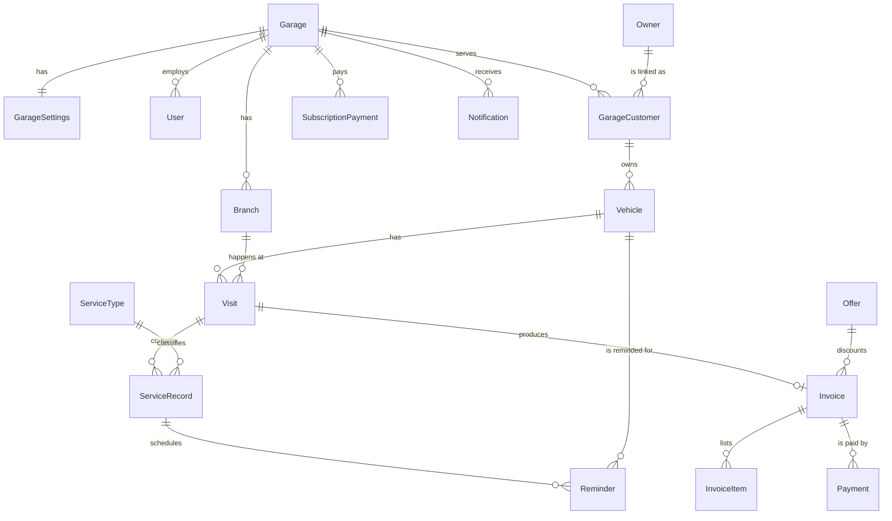

# Gearva — Database design

PostgreSQL 16+, managed with Prisma 7 in `packages/database`. This file describes the data model, the tenant-isolation design, and the rules the schema must enforce. It is the source for `schema.prisma`. Behavior that uses these tables is described in `flow.md`.

---

## 1. Conventions

| Topic | Rule |
|---|---|
| Table / column names | Prisma models are `PascalCase` / `camelCase`, mapped with `@@map` / `@map` to `snake_case` plural tables (`garage_customers`, `garage_id`) |
| IDs | UUID v7: `id String @id @default(uuid(7)) @db.Uuid` |
| Timestamps | `createdAt`, `updatedAt` on every table, `timestamptz`, stored in UTC |
| Money | Integer **cents** (`Int`), currency USD. Column suffix `Cents`. Never `Float`/`Decimal` for money |
| Distance | Integer **km** (`Int`), column suffix `Km`. Miles only at the display edge (1 mi = 1.609344 km) |
| Phone numbers | E.164 string (`+9613123456`), normalized before save with `phoneSchema` / `normalizePhone` from `packages/contracts` (libphonenumber-js; a number without a country code is read as Lebanese). Invalid numbers are refused |
| Plates | Store `plate` (as typed) and `plateNormalized` (uppercase, no spaces or dashes) for search and uniqueness |
| Enums | Prisma enums, listed in section 5 |
| Deletion | Invoices, payments, service records and audit rows are **never deleted**. Garages, customers and vehicles use soft delete (`deletedAt`) |
| Tenant column | Every tenant table has `garageId` (`garage_id`), `NOT NULL`, indexed, with a foreign key to `garages`. One exception: `audit_logs.garageId` is nullable for admin/system actions that belong to no garage (see 4.6) |
| Forward references | A column that points to a table built in a later phase is created as a plain `uuid` column with **no foreign key**; the FK is added in the migration that creates the target table (see section 10) |

---

## 2. Table groups

| Group | Tables | Tenant (`garage_id`)? | RLS |
|---|---|---|---|
| Platform | `admin_users`, `admin_access_logs`, `sessions`, `system_settings`, `subscription_payments`, `owners`, `owner_otps`, `device_tokens` | No | No (only reachable from admin/auth code) |
| Tenant root | `garages` | It is the tenant (`id`) | Yes, `id = app.garage_id` |
| Tenant data | `garage_settings`, `branches`, `users`, `garage_customers`, `vehicles`, `service_types`*, `suggestions`, `visits`, `service_records`, `reminders`, `invoices`, `invoice_items`, `invoice_counters`, `payments`, `offers`, `notifications`, `files`, `audit_logs` | Yes | Yes |

\* `service_types` holds global defaults (`garage_id IS NULL`, readable by everyone, managed by admin) and garage overrides (`garage_id` set). See its special policy below.

---

## 3. Entity relationship overview



Key idea: **an `Owner` is global (one per phone number). A `GarageCustomer` is the per-garage link between a garage and an owner.** Vehicles, visits, invoices and notes all hang off the garage-side records, so a garage never sees another garage's data, while the owner app can still combine histories through `ownerId`.

---

## 4. Tables

Legend: **PK** primary key, **FK** foreign key, **U** unique, `?` nullable. All tables also have `createdAt`/`updatedAt` unless noted. Tenant tables include `garageId` (FK to `garages`) even when not repeated below.

### 4.1 Platform tables (no `garage_id`)

#### `admin_users`
| Column | Type | Notes |
|---|---|---|
| id | uuid PK | |
| email | text U | |
| passwordHash | text | argon2id |
| name | text | |
| role | AdminRole | `SUPER_ADMIN`, `ADMIN` |
| totpSecretEnc | text? | encrypted TOTP secret |
| totpEnabled | bool | 2FA is optional (default false); when true, login also needs a TOTP or recovery code |
| recoveryCodesHash | text[] | |
| isActive | bool | |
| lastLoginAt | timestamptz? | |

#### `sessions`
| Column | Type | Notes |
|---|---|---|
| id | uuid PK | |
| subjectType | SubjectType | `STAFF`, `ADMIN`, `OWNER` |
| subjectId | uuid | id in `users` / `admin_users` / `owners` |
| refreshTokenHash | text U | rotated on every refresh |
| userAgent, ip | text? | |
| expiresAt | timestamptz | |
| revokedAt | timestamptz? | |

#### `owners` (global car-owner accounts)
| Column | Type | Notes |
|---|---|---|
| id | uuid PK | |
| phone | text U | E.164, the login identity |
| name | text | name given by the first garage that added them |
| email | text? | |
| locale | text | `ar` or `en`, used for invoices and notifications |
| lastLoginAt | timestamptz? | null means the app was never used |

#### `owner_otps`
`id`, `ownerId` FK, `codeHash`, `expiresAt`, `attempts` int, `consumedAt?`. Max 5 attempts, 10 minute expiry.

#### `device_tokens` (phase 6)
`id`, `ownerId` FK, `token` U, `platform` (`ios`/`android`), `lastSeenAt`.

#### `subscription_payments`
| Column | Type | Notes |
|---|---|---|
| id | uuid PK | |
| garageId | uuid FK | |
| amountCents | int | |
| method | PaymentMethod | `CASH`, `WHISH` |
| paidAt | timestamptz | |
| periodStart / newExpiryDate | date | the new expiry date set by this payment |
| extraBranches | int | extra branches included in this payment |
| recordedById | uuid FK | admin user |
| note | text? | |

#### `admin_access_logs`
Append-only. `id`, `adminId` FK, `garageId` FK, `action` (`VIEW_AS_GARAGE_START`, `VIEW_AS_GARAGE_END`, `RECORD_VIEWED`), `path`, `ip`, `createdAt`. Every time an admin opens a garage's data, a row is written.

#### `system_settings`
Key/value (`key` PK, `value` jsonb). Examples: `reminder.sendTimeLocal`, `reminder.daytimeStart`, `reminder.daytimeEnd`, `reminder.maxPerGaragePerMonth`, `invoice.defaultTemplate`, `subscription.defaultPriceCents`, `subscription.extraBranchPriceCents`, `trial.days`, `usage.defaultDailyKm`.

### 4.2 Tenant root and settings

#### `garages`
| Column | Type | Notes |
|---|---|---|
| id | uuid PK | the tenant id |
| name | text | business name |
| email | text | |
| phone | text | |
| locationText | text | |
| timezone | text | default `Asia/Beirut` |
| defaultLocale | text | `ar` / `en` |
| status | GarageStatus | `TRIAL`, `ACTIVE`, `EXPIRED`, `SUSPENDED` |
| isPaid | bool | the admin-set paid flag |
| trialEndsAt | timestamptz? | |
| expiresAt | timestamptz? | subscription end; lock when in the past |
| suspendedAt / suspendedReason | timestamptz? / text? | |
| createdByAdminId | uuid FK | |
| lastLoginAt | timestamptz? | denormalized for the admin "inactive garages" list |
| deletedAt | timestamptz? | soft delete |

The branch count is derived from active `branches` rows (extra branches are billed separately, so the admin sees `COUNT(branches) - 1`).

#### `garage_settings` (1:1 with garage, `garageId` is PK)
`logoFileId?` (FK to `files` added in the Phase 3 migration), `brandColor` (default `#111827`), `invoiceNumberFormat` (default `{BRANCH}-{YYYY}-{SEQ:4}`), `termsText?`, `autoSendInvoice` bool (default false), `showLbp` bool (default false), `lbpRate` int? (LBP per 1 USD, display only), `vatEnabled` bool (default false), `vatRatePercent` numeric(5,2)?, `vatNumber?`, `paymentReminderDays` int?, `reminderLeadKm` int (default 500), `reminderLeadDays` int (default 7), `defaultDailyKm` int?, `invoiceEditWindow` (default `SAME_DAY`).

`invoiceEditWindow` is added in the Phase 3 migration, together with its enum, because its possible values are defined by the invoice edit rules (flow.md section 7.5). All other columns exist from Phase 1.

#### `branches`
`id`, `garageId`, `name`, `code` (e.g. `BR1`, **U** per garage), `address?`, `phone?`, `isMain` bool, `isActive` bool.

A branch with active staff cannot be deactivated (`BRANCH_HAS_STAFF`): the owner moves or deactivates them first, because work is recorded per branch. An active staff member can never be placed in, or reactivated into, an inactive branch (`BRANCH_INACTIVE`). The main branch is never deactivated (`MAIN_BRANCH_REQUIRED`).

#### `users` (garage staff)
| Column | Type | Notes |
|---|---|---|
| id | uuid PK | |
| garageId | uuid FK | |
| branchId | uuid? FK | null means access to all branches (owner/manager) |
| email | text U | globally unique (login identity) |
| passwordHash | text? | null until the invite is accepted |
| name | text | |
| role | StaffRole | `OWNER`, `MANAGER`, `MECHANIC`, `RECEPTIONIST` |
| locale | text | |
| isActive | bool | |
| inviteTokenHash / inviteExpiresAt | text? / timestamptz? | invite and password-reset link |
| lastLoginAt | timestamptz? | |

Each garage has exactly one `OWNER` created by the admin when the garage is created. Credential lookup at login happens before a tenant context exists, so the auth module reads `users` by email through the platform DB role (section 6).

### 4.3 Customers and vehicles

#### `garage_customers`
| Column | Type | Notes |
|---|---|---|
| id | uuid PK | |
| garageId | uuid FK | |
| ownerId | uuid FK | find-or-create `owners` by phone when adding |
| name | text | the garage's own name for the customer |
| notes | text? | private to this garage |
| inviteSentAt | timestamptz? | |
| remindersOptOut / marketingOptOut | bool | honored by every channel |
| deletedAt | timestamptz? | |
| **U** | (garageId, ownerId) | one link per garage and owner |

The phone number lives on `owners`. Searching a garage's customers by phone joins `owners` and is always scoped through `garage_customers`, so a garage can never browse the global owners table.

#### `vehicles`
| Column | Type | Notes |
|---|---|---|
| id | uuid PK | |
| garageId | uuid FK | |
| garageCustomerId | uuid FK | |
| ownerId | uuid FK | denormalized from the customer, used by the owner app |
| plate / plateNormalized | text | |
| make / model | text | normalized through `suggestions` |
| year | int? | |
| distanceUnit | DistanceUnit | `KM` or `MI` display unit for this car |
| currentKm | int | last recorded odometer, in km |
| lastOdometerAt | timestamptz? | when `currentKm` was recorded |
| avgDailyKm | numeric(7,2)? | recalculated after each visit (flow.md section 5) |
| notes | text? | |
| deletedAt | timestamptz? | |
| **U** (partial) | (garageId, plateNormalized) where deletedAt is null | |

### 4.4 Services, visits, records

#### `service_types`
| Column | Type | Notes |
|---|---|---|
| id | uuid PK | |
| garageId | uuid? FK | null = global default (managed in V2); set = garage override |
| code | text | `OIL_CHANGE`, `WHEELS`, `STEERING_OIL`, `TRANSMISSION_OIL`, `DIFFERENTIAL_OIL`, `GEAR_OIL`, `BATTERY`, `ENGINE`, `BRAKES`, `AC`, `OTHER` |
| nameAr / nameEn | text | |
| defaultIntervalKm | int? | null = time-based only |
| defaultIntervalMi | int? | editable separately from km, per the spec |
| defaultIntervalMonths | int? | time fallback |
| detailKey | text | which Zod schema validates `ServiceRecord.details` (e.g. `wheels`, `oil`, `battery`, `brakes`, `ac`) |
| sortOrder | int | |
| isActive | bool | |
| **U** | (garageId, code) with global rows treated as distinct (use two partial unique indexes) | |

Special RLS: `SELECT` allowed when `garage_id IS NULL OR garage_id = app.garage_id`; `INSERT/UPDATE/DELETE` only for `garage_id = app.garage_id`. When a garage edits a default, an override row is created. Lookup order: garage override, then global default.

**Starting values for the seed (confirm before launch; garages can override):**

| Code | km | miles | months |
|---|---|---|---|
| OIL_CHANGE | 5000 | 3600 | 6 |
| WHEELS (rotation) | 10000 | 6000 | 6 |
| STEERING_OIL | 40000 | 25000 | 24 |
| TRANSMISSION_OIL | 60000 | 40000 | 36 |
| DIFFERENTIAL_OIL | 60000 | 40000 | 36 |
| GEAR_OIL | 40000 | 25000 | 24 |
| BRAKES | 30000 | 20000 | 12 |
| BATTERY | none | none | 24 |
| AC | none | none | 12 |
| ENGINE | none | none | none |
| OTHER | none | none | none |

#### `suggestions` (per-garage autocomplete)
| Column | Type | Notes |
|---|---|---|
| id | uuid PK | |
| garageId | uuid FK | |
| field | SuggestionField | `OIL_BRAND`, `OIL_GRADE`, `FILTER_BRAND`, `BATTERY_BRAND`, `TIRE_BRAND`, `BRAKE_PAD_BRAND`, `SERVICE_NAME`, `VEHICLE_MAKE`, `VEHICLE_MODEL` |
| value | text | display value as first typed ("Castrol") |
| valueNormalized | text | lowercase, trimmed, collapsed spaces |
| useCount | int | most-used appear first |
| lastUsedAt | timestamptz | |
| **U** | (garageId, field, valueNormalized) | prevents "Castrol" vs "castrol" duplicates |

Index for prefix search: `(garageId, field, valueNormalized text_pattern_ops)`.

#### `visits`
| Column | Type | Notes |
|---|---|---|
| id | uuid PK | |
| garageId, branchId | uuid FK | |
| vehicleId | uuid FK | |
| garageCustomerId | uuid FK | |
| ownerId | uuid FK | denormalized |
| mechanicId | uuid FK | the logged-in user who opened it |
| status | VisitStatus | `IN_PROGRESS`, `WAITING_FOR_PARTS`, `DONE` |
| odometerKm | int | in km |
| openedAt | timestamptz | |
| finishedAt | timestamptz? | set by "Finish visit", which also creates the invoice |
| notes | text? | |

A finished visit is locked: its records can only change through the invoice edit rules in flow.md.

#### `service_records`
| Column | Type | Notes |
|---|---|---|
| id | uuid PK | |
| garageId, branchId | uuid FK | |
| visitId | uuid FK | |
| vehicleId | uuid FK | |
| ownerId | uuid FK | denormalized |
| serviceTypeId | uuid FK | |
| customName | text? | used when the type is `OTHER` |
| performedAt | timestamptz | |
| odometerKm | int | km at service time |
| quantity | numeric(8,2) | default 1 |
| unitPriceCents | int | |
| totalCents | int | quantity x unit price |
| laborCents / partsCents | int? | optional split |
| mechanicId | uuid FK | from the logged-in user |
| notes | text? | |
| details | jsonb | service-specific fields, validated by the schema named in `serviceTypes.detailKey` |
| warrantyUntil | date? | |
| recommendedNote | text? | e.g. "brake pads at 30%, check in 3 months" |
| recommendedAfterMonths | int? | can become a reminder |
| nextDueKm / nextDueDate | int? / date? | computed on save (flow.md section 4) |

`details` shapes (all optional fields unless stated):
- `oil`: `{ brand, grade, filterBrand, liters, filterChanged }`
- `wheels`: `{ tireBrand, tireSize, alignment, balancing, rotation }`
- `battery`: `{ brand, amps, warrantyMonths }`
- `brakes`: `{ position: "FRONT" | "REAR", part: "PADS" | "DISCS", padBrand }`
- `ac`: `{ gasRefill, filterChanged, compressor }`

Paid / not paid is **not** stored here. Payment lives on the invoice (one payment per visit), and the UI derives the paid state from the invoice.

#### `reminders`
| Column | Type | Notes |
|---|---|---|
| id | uuid PK | |
| garageId | uuid FK | |
| vehicleId | uuid FK | |
| ownerId | uuid FK | |
| serviceTypeId | uuid? FK | |
| sourceRecordId | uuid FK | the record that created it |
| kind | ReminderKind | `SERVICE_DUE`, `WARRANTY_END`, `RECOMMENDED_NEXT` |
| nextDueKm | int? | in km |
| nextDueDate | date? | time fallback |
| status | ReminderStatus | `ACTIVE`, `SENT`, `COMPLETED`, `CANCELLED` |
| notifyCount | int | |
| lastNotifiedAt | timestamptz? | |

Saving a new record for the same vehicle and service type marks the previous `ACTIVE` or `SENT` reminder `COMPLETED` and creates a new `ACTIVE` one.

### 4.5 Invoices and payments

#### `invoice_counters`
`garageId`, `branchId`, `year` int, `lastNumber` int. **PK** (branchId, year). Used for gap-free numbering.

#### `invoices`
| Column | Type | Notes |
|---|---|---|
| id | uuid PK | |
| garageId, branchId | uuid FK | |
| visitId | uuid FK | one visit = one active invoice (partial unique index, see below). A cancelled invoice keeps its visit, and the reissued invoice points back to it through `replacesInvoiceId` |
| garageCustomerId, ownerId, vehicleId | uuid FK | |
| number | text | e.g. `BR1-2026-0001`, **U** (garageId, number) |
| seq / year | int | the numeric parts |
| status | InvoiceStatus | `UNPAID`, `PARTIALLY_PAID`, `PAID`, `CANCELLED` |
| issuedAt | timestamptz | |
| locale | text | follows the customer (`owners.locale`) |
| subtotalCents | int | |
| discountType | DiscountType? | `AMOUNT`, `PERCENT` |
| discountValue | int? | cents or percent |
| discountCents | int | resulting discount |
| vatCents | int | 0 unless VAT is on |
| totalCents | int | |
| paidCents | int | maintained inside the payment transaction |
| remainingCents | int | `totalCents - paidCents` |
| laborCents / partsCents | int? | |
| offerId | uuid? FK | the offer used |
| nextServiceKm / nextServiceDate | int? / date? | the earliest due of the visit |
| warrantyText | text? | |
| termsSnapshot | text? | garage terms at issue time |
| customerSnapshot / vehicleSnapshot / garageSnapshot | jsonb | name, phone, plate, make, model, year, odometer, garage header, so the invoice never changes if master data changes |
| qrToken | text U | optional QR verification token |
| pdfFileId | uuid? FK | cached PDF |
| cancelledAt / cancelReason / cancelledById | timestamptz? / text? / uuid? | reason is required to cancel |
| replacesInvoiceId | uuid? FK | the cancelled invoice this one replaces |
| createdById / lastEditedById | uuid FK | |

`visitId` uniqueness: to allow reissue after cancel, make the unique index **partial**: `UNIQUE (visitId) WHERE status <> 'CANCELLED'`.

#### `invoice_items`
`id`, `garageId`, `invoiceId` FK, `serviceRecordId?` FK, `description` (service name in the invoice language), `brand?`, `grade?`, `quantity` numeric(8,2), `unitPriceCents`, `totalCents`, `position` int. Copied from service records when the invoice is created.

#### `payments`
| Column | Type | Notes |
|---|---|---|
| id | uuid PK | |
| garageId | uuid FK | |
| invoiceId | uuid FK | |
| amountCents | int | `> 0` |
| method | PaymentMethod | `CASH`, `WHISH` |
| paidAt | timestamptz | |
| receivedById | uuid FK | |
| note | text? | |

Payments are append-only. Rule: `SUM(payments.amountCents) = invoices.paidCents`, enforced in the service inside one transaction and covered by a test.

### 4.6 Offers, notifications, files, audit

#### `offers`
`id`, `garageId`, `title`, `body`, `imageFileId?`, `discountType`, `discountValue`, `startsAt`, `expiresAt?`, `target` (`ALL`, `OVERDUE`, `INACTIVE_6M`), `isActive`, `createdById`. Redemptions are counted from `invoices.offerId`. The table is created in the Phase 3 migration (with the invoices), even though the offer screens and broadcasts are built in Phase 7.

#### `notifications` (log and in-app inbox in one table)
| Column | Type | Notes |
|---|---|---|
| id | uuid PK | |
| garageId | uuid FK | |
| ownerId | uuid? FK | recipient owner (customer). The table is created in Phase 1 before `owners` exists, so the FK is added in the Phase 2 migration |
| userId | uuid? FK | recipient staff member, for in-app staff notices |
| channel | NotificationChannel | `EMAIL`, `IN_APP`, `PUSH`, `WHATSAPP` |
| type | NotificationType | `SERVICE_REMINDER`, `MONTHLY_REMINDER`, `INVOICE`, `OFFER`, `INVITE`, `CAR_READY`, `WARRANTY_END`, `PAYMENT_REMINDER` |
| template | text | |
| locale | text | |
| recipient | text? | email, phone or token used |
| payload | jsonb | template data |
| status | NotificationStatus | `QUEUED`, `SENT`, `DELIVERED`, `FAILED`, `SKIPPED` |
| error | text? | failure reason |
| dedupeKey | text | **U** (garageId, dedupeKey) prevents duplicates |
| scheduledFor / sentAt / deliveredAt | timestamptz? | |
| readAt | timestamptz? | for `IN_APP` |
| refType / refId | text? / uuid? | e.g. `reminder`, `invoice`, `offer` |

Dedupe key examples: `SERVICE_REMINDER:{reminderId}:{notifyCount}`, `MONTHLY_REMINDER:{ownerId}:2026-10`, `INVOICE:{invoiceId}:EMAIL`, `INVITE:{userId}:{issuedAtMs}`, `PASSWORD_RESET:{userId}:{issuedAtMs}`.

Invite and password-reset emails use type `INVITE` with templates `staff-invite` and `password-reset`. **Their `payload` holds the one-time set-password link**, so no screen may show `payload` (the Phase 4 notification log shows type, channel, recipient, status and error only); otherwise a manager could open the owner's reset link.

#### `files`
`id`, `garageId`, `kind` (`LOGO`, `SERVICE_PHOTO`, `INVOICE_PDF`, `OFFER_IMAGE`), `storageKey`, `mimeType`, `sizeBytes`, `serviceRecordId?`, `createdById`. Photos belong to a service record. Access is always through the API (signed, short-lived URLs).

#### `audit_logs` (append-only, `createdAt` only, no `updatedAt`)
| Column | Type | Notes |
|---|---|---|
| id | uuid PK | |
| garageId | uuid? FK | the garage the action touched. `NULL` only for admin/system actions that touch no garage (admin login, admin user changes, system settings) |
| actorType | ActorType | `STAFF`, `ADMIN`, `OWNER`, `SYSTEM` |
| actorId | uuid? | |
| action | text | `customer.view`, `invoice.cancel`, `invoice.reprint`, `invoice.edit`, `payment.create`, ... |
| entityType / entityId | text / uuid? | |
| before / after | jsonb? | for edits |
| ip / userAgent | text? | |

The runtime role has `INSERT` and `SELECT` only on this table (no `UPDATE`/`DELETE`). The normal tenant policy applies, so rows with `garage_id IS NULL` are invisible to `gearva_app` (`NULL = x` never matches). The admin module writes and reads its own rows (including the `NULL` ones) through `gearva_platform`. Staff login attempts that fail before a garage is known are not audit rows; they are covered by rate limiting.

---

## 5. Enums

```
GarageStatus        TRIAL | ACTIVE | EXPIRED | SUSPENDED
StaffRole           OWNER | MANAGER | MECHANIC | RECEPTIONIST
AdminRole           SUPER_ADMIN | ADMIN
SubjectType         STAFF | ADMIN | OWNER
ActorType           STAFF | ADMIN | OWNER | SYSTEM
DistanceUnit        KM | MI
VisitStatus         IN_PROGRESS | WAITING_FOR_PARTS | DONE
InvoiceStatus       UNPAID | PARTIALLY_PAID | PAID | CANCELLED
PaymentMethod       CASH | WHISH
DiscountType        AMOUNT | PERCENT
ReminderKind        SERVICE_DUE | WARRANTY_END | RECOMMENDED_NEXT
ReminderStatus      ACTIVE | SENT | COMPLETED | CANCELLED
NotificationChannel EMAIL | IN_APP | PUSH | WHATSAPP
NotificationType    SERVICE_REMINDER | MONTHLY_REMINDER | INVOICE | OFFER | INVITE | CAR_READY | WARRANTY_END | PAYMENT_REMINDER
NotificationStatus  QUEUED | SENT | DELIVERED | FAILED | SKIPPED
SuggestionField     OIL_BRAND | OIL_GRADE | FILTER_BRAND | BATTERY_BRAND | TIRE_BRAND | BRAKE_PAD_BRAND | SERVICE_NAME | VEHICLE_MAKE | VEHICLE_MODEL
OfferTarget         ALL | OVERDUE | INACTIVE_6M
```

Enum values are mirrored in `packages/contracts` so the API, web and mobile apps share them.

---

## 6. Tenant isolation design (Postgres RLS)

### 6.1 Database roles

| Role | Used by | Rights |
|---|---|---|
| `gearva_migrator` | `prisma migrate` only | Owns the schema, runs DDL |
| `gearva_app` | The API at runtime (`DATABASE_URL`) | `NOSUPERUSER NOBYPASSRLS`. CRUD on tables, except **INSERT + SELECT only** on `audit_logs` and `payments` (no UPDATE or DELETE) |
| `gearva_platform` | Admin module and auth credential lookups (`PLATFORM_DATABASE_URL`) | `BYPASSRLS`. Used only for: admin usage counts, login lookups, daily jobs that iterate garages. Any use that reads garage records must write an `admin_access_logs` row |

**Creating the roles.** Roles are cluster-level and need a superuser (or `CREATEROLE`), which `gearva_migrator` must not have, so they are **not** created in a Prisma migration. Instead:
- A one-time bootstrap script `packages/database/sql/bootstrap-roles.sql` creates the three roles (passwords from env) and makes `gearva_migrator` the owner of the database's `public` schema. Locally, Docker Compose runs it on first start of an empty Postgres volume. On Render, run it once as the admin user from the dashboard's shell or `psql`.
- Every Prisma migration (run as `gearva_migrator`) grants rights on **the tables it creates**, by name: `SELECT, INSERT, UPDATE, DELETE` to `gearva_app` and `gearva_platform` (platform tables from section 2 go to `gearva_platform` only, unless the table's section says the API needs them under tenant context), or `SELECT, INSERT` only for append-only tables (`audit_logs`, `payments`). There are no default privileges, so a new table has no access until its migration grants it, and neither runtime role has any right on `_prisma_migrations`. Keep the passwords in env variables.

**Managed Postgres note (Render):** managed databases usually do not let you grant `BYPASSRLS`. If that is the case, do not give `gearva_platform` that attribute. Instead add an explicit policy for that role on every tenant table:

```sql
CREATE POLICY platform_access ON vehicles TO gearva_platform USING (true) WITH CHECK (true);
```

The isolation guarantees stay the same, because `gearva_app` still only matches its own `garage_id`. Also confirm early (Phase 1) that the hosting plan lets you create the three roles. If it only gives one database user, tell me and we will adjust the role design.

### 6.2 Policy pattern

Applied to **every** table that has `garage_id`:

```sql
ALTER TABLE vehicles ENABLE ROW LEVEL SECURITY;
ALTER TABLE vehicles FORCE ROW LEVEL SECURITY;

CREATE POLICY tenant_isolation ON vehicles
  USING      (garage_id = NULLIF(current_setting('app.garage_id', true), '')::uuid)
  WITH CHECK (garage_id = NULLIF(current_setting('app.garage_id', true), '')::uuid);
```

If `app.garage_id` is not set, the policy matches nothing, so a forgotten context returns zero rows instead of leaking data. For `garages`, the condition is `id = ...`.

### 6.3 Setting the context from Prisma

Every request runs its queries in a transaction that starts with:

```sql
SELECT set_config('app.garage_id', $1, true);   -- true = local to this transaction
```

This is implemented once as `runAsTenant(client, garageId, fn)` in `packages/database/src/tenant.ts`: an interactive `$transaction` that runs `set_config` first and then `fn(tx)`. The API uses it only through `TenantDb.run(fn)` (`apps/api/src/common/db`), which takes the garage from the request context. Application code never calls `set_config` directly and never gets the raw `gearva_app` client.

Why not a `$allOperations` client extension: it wraps each query in its own batch transaction, so it cannot hold a row lock across several queries. Invoice numbering and payments (flow.md sections 7.1 and 8.1) need exactly that, so one explicit transaction per unit of work is used instead.

### 6.4 Owner (mobile) access

The owner app reads across garages by `ownerId`. In phase 6, add a second read policy on the owner-facing tables (`vehicles`, `visits`, `service_records`, `invoices`, `reminders`, `notifications`):

```sql
CREATE POLICY owner_read ON invoices FOR SELECT
  USING (owner_id = NULLIF(current_setting('app.owner_id', true), '')::uuid);
```

`invoice_items` and `payments` get the same through `EXISTS` on their invoice. The `ownerId` columns already exist from phase 2, so this needs no data migration. Owner policies are `SELECT` only.

### 6.5 Guard rails
- A test queries `pg_tables`/`pg_policies` and **fails if any table with a `garage_id` column has no RLS policy**.
- The tenancy suite (`npm run test:tenancy`) runs through the HTTP API with two garages.
- Migrations that add a tenant table must add its policy in the same migration. Keep the list of tenant tables in one place (`packages/database/src/tenant-tables.ts`) and generate the policy SQL from it (`npm run rls:sql -w @gearva/database -- <table>`).

---

## 7. Indexes and constraints (minimum set)

```
garages            (status, expiresAt)
users              U(email); U(inviteTokenHash); (garageId, role); U(garageId) WHERE role = 'OWNER' (exactly one owner)
branches           U(garageId, code)
garage_customers   U(garageId, ownerId); (garageId, deletedAt)
owners             U(phone)
vehicles           U(garageId, plateNormalized) WHERE deletedAt IS NULL; (garageId, garageCustomerId); (ownerId)
visits             (garageId, branchId, openedAt DESC); (vehicleId, openedAt DESC)
service_records    (vehicleId, serviceTypeId, performedAt DESC); (garageId, performedAt DESC); (visitId)
suggestions        U(garageId, field, valueNormalized); prefix index (see 4.4)
reminders          (garageId, status, nextDueDate); (vehicleId, serviceTypeId, status)
invoices           U(garageId, number); U(visitId) WHERE status <> 'CANCELLED'; (garageId, status); (garageCustomerId); (garageId, issuedAt DESC)
invoice_items      (invoiceId)
payments           (invoiceId); (garageId, paidAt)
notifications      U(garageId, dedupeKey); (garageId, status, scheduledFor); (ownerId, readAt)
audit_logs         (garageId, createdAt DESC); (entityType, entityId)
sessions           U(refreshTokenHash); (subjectType, subjectId)
```

CHECK constraints:
- `payments.amountCents > 0`
- `invoices.paidCents >= 0 AND invoices.paidCents <= invoices.totalCents`
- `invoices.remainingCents = invoices.totalCents - invoices.paidCents`
- `vehicles.currentKm >= 0`, `service_records.odometerKm >= 0`
- `invoices.status = 'CANCELLED'` requires `cancelReason IS NOT NULL`

---

## 8. Derived values (not stored, or cached)

| Value | How |
|---|---|
| Estimated current km | `currentKm + avgDailyKm x days since lastOdometerAt` (flow.md section 5) |
| Service history timeline | `service_records` for a vehicle ordered by `performedAt DESC` |
| Debt list | invoices with status `UNPAID` or `PARTIALLY_PAID`, grouped by customer |
| Customer value | `SUM(invoices.totalCents)` where status is not `CANCELLED`, per customer |
| Revenue per day / month / year / service / branch | aggregates over `payments` (cash received) or `invoices` (invoiced). Decide which one the screen shows and label it clearly |
| Offer redemptions | `COUNT(invoices WHERE offerId = X AND status <> 'CANCELLED')` |
| Garage usage (admin) | counts of customers, vehicles, invoices, notifications per garage via `gearva_platform` |
| Branch count | `COUNT(branches WHERE isActive)` |

---

## 9. Seed data (`npm run db:seed`)

1. One `SUPER_ADMIN` (email and password from env; 2FA is optional and can be turned on from the Account page). Added in Phase 1 step 1.4.
2. Global `service_types` with the starting values from section 4.4. Added in Phase 2.
3. `system_settings` defaults. Added with the phases that read them.
4. Development only: a demo garage with owner login, two branches, a few customers, vehicles and visits. Added in step 1.6: "Demo Garage" (ACTIVE, paid for a year, branches BR1 and BR2) with an OWNER whose login is `SEED_DEMO_OWNER_EMAIL` / `SEED_DEMO_OWNER_PASSWORD`; skipped in production or when those are empty. Customers, vehicles and visits are added in Phase 2.

The seed is `packages/database/src/seed.ts`, compiled with the package. It only creates missing rows and never changes existing ones.

---

## 10. Migration workflow

- Change `schema.prisma`, then from `packages/database` run `npx prisma migrate dev --create-only --name <what_changed>`, add the hand-written SQL (grants, RLS, partial indexes, CHECKs) to the generated file, then `npx prisma migrate dev` to apply it. Run Prisma directly like this rather than `npm run db:migrate -- --name ...`: Windows PowerShell drops the `--`, so the flags never reach Prisma.
- Prisma cannot express RLS policies, partial unique indexes or CHECK constraints. Add them as raw SQL in the same migration folder.
- Never edit a migration that has already been applied anywhere. Create a new one.
- Forward references (section 1): when a migration creates a table that an earlier table already points to, the same migration adds the missing FK. Known cases: `notifications.ownerId` → `owners` (Phase 2), `garage_settings.logoFileId` → `files` (Phase 3).
- Production: `prisma migrate deploy` runs as a separate deploy step using `MIGRATION_DATABASE_URL`.
