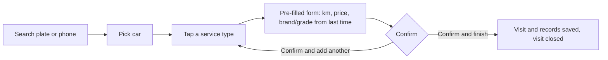
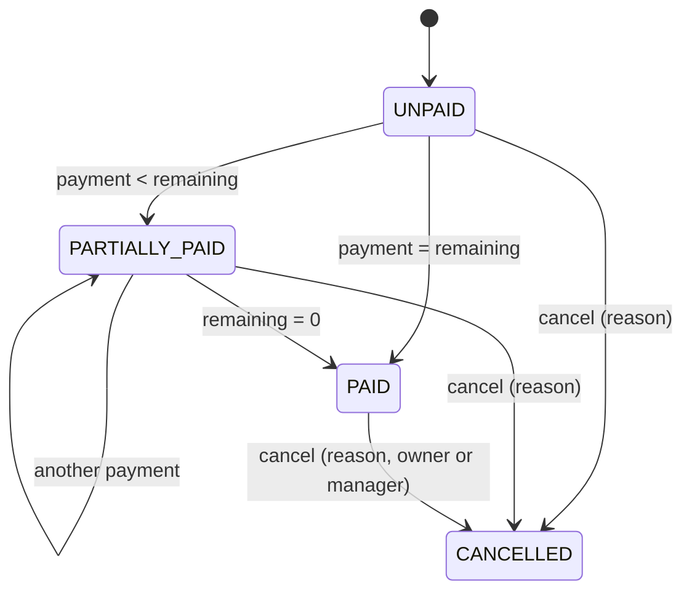
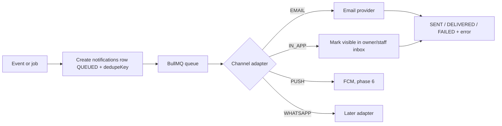
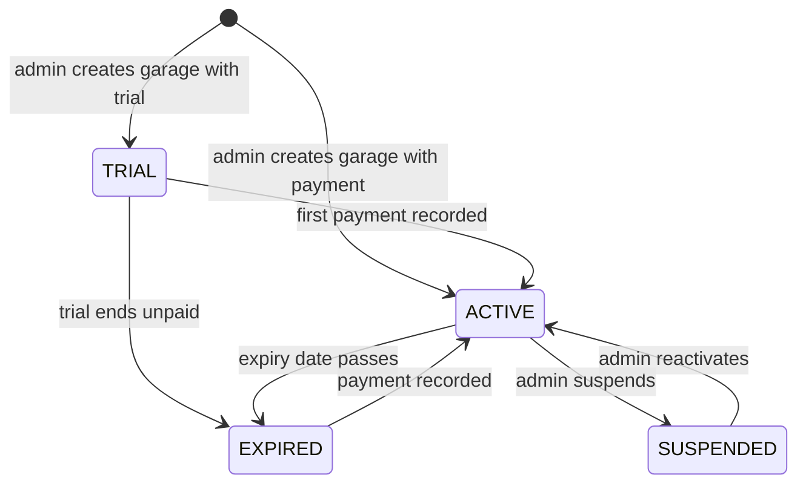

# Gearva — System flows

How the system behaves, step by step. `database.md` defines the tables used here and `README.md` defines the rules and build order. Each section names the roadmap phase that implements it.

---

## 1. Actors and permissions

| Actor | App | How they log in |
|---|---|---|
| Super admin / admin | V2 `admin` | Email + password, plus a TOTP code if the admin turned on 2FA (optional, recommended) |
| Garage OWNER | V1 `garage-web` | Email + password (invite link sets the password) |
| MANAGER, MECHANIC, RECEPTIONIST | V1 `garage-web` | Email + password |
| Car owner (customer) | V3 `mobile` | Phone number + one-time code |
| System | background jobs | n/a |

### Garage permission matrix (V1)

| Action | OWNER | MANAGER | MECHANIC | RECEPTIONIST |
|---|---|---|---|---|
| Add / edit customers and vehicles | yes | yes | yes | yes |
| Quick entry, create visits and service records | yes | yes | yes | no |
| Finish visit (creates invoice) | yes | yes | yes | no |
| Record a payment | yes | yes | no | yes |
| Edit an invoice the same day | yes | yes | yes (own visits) | no |
| Edit an invoice after the same day | yes | no | no | no |
| Cancel an invoice | yes | yes | no | no |
| See revenue screens, debt list | yes | yes | no | debt list only |
| Offers and broadcasts | yes | yes | no | no |
| Staff, branches, garage settings | yes | no | no | no |
| Switch branch view (all branches) | yes | yes | no, own branch only | no, own branch only |

This matrix is enforced by a `RolesGuard` in the API. The web app hides what a role cannot use, but the API is the real check.

---

## 2. Access and accounts (Phase 1)

### 2.1 Admin creates a garage
1. Admin opens "New garage" in V2 and enters business name, email, phone, location text, and either ticks a free trial (30 days) or enters a **paid-until date** (required when there is no trial).
2. API (`POST /admin/v1/garages`), in one transaction, creates: `garages` row (`status = TRIAL` with `trialEndsAt`, or `status = ACTIVE` with `isPaid = true` and `expiresAt` = the paid-until date), `garage_settings` with defaults, one main `branches` row (`code = BR1`), and one `users` row with `role = OWNER`, no password yet.
3. API generates a single-use invite token (stored hashed, expires in 7 days) and queues an `INVITE` email to the garage's email with a link to `app.gearva.online/set-password?token=...`.
4. The owner opens the link, sets a password, and is logged in.
5. Admin can regenerate the invite or trigger a password reset from V2 at any time.

Details (Phase 1, step 1.5):
- The garage email is also the owner's login email (`users.email` is globally unique, so an email that is already a login is refused with `EMAIL_ALREADY_USED` and nothing is created). The admin also enters the owner's name.
- Trial: `trialEndsAt = now + 30 days` (constant until `trial.days` exists in Phase 5). Paid: the admin picks the last paid day; `expiresAt` is the end of that day (UTC).
- Main branch: `code = BR1`, named after the garage.
- Links: the invite lasts 7 days; a password reset lasts 24 hours. Both are `app.gearva.online/set-password?token=...` and share `users.inviteTokenHash` (only the token's SHA-256 is stored); a new link replaces the previous one. Resend invite only while the owner has no password (`OWNER_ALREADY_ACTIVE`), reset only after (`OWNER_NOT_ACTIVATED`).
- Endpoints: `POST /admin/v1/garages`, `GET /admin/v1/garages` (`q`, `status`, pagination), `GET /admin/v1/garages/:garageId`, `POST .../:garageId/invite`, `.../password-reset`, `.../suspend` (reason required), `.../reactivate` (back to `TRIAL` if unpaid with a trial, else `ACTIVE`). Each mutation writes an audit row with the garage id.

### 2.2 Login (garage staff)
1. `POST /v1/auth/login` with email and password.
2. Auth looks up the user by email (platform DB role), checks `isActive`, verifies the argon2 hash, and loads the garage.
3. If the garage is `SUSPENDED` or expired, return `GARAGE_LOCKED` (the web app shows a lock screen with the garage's renewal message).
4. Otherwise create a session, set httpOnly access (15 min) and refresh (30 days, rotated) cookies, host-only on `app.gearva.online` through the app's API forwarding (README 5.2).
5. Login attempts are rate limited per IP and per email.

Details (Phase 1, step 1.6):
- **Set password** (`POST /v1/auth/set-password` with `token` and `password`, at least 10 characters): the invite and the reset link both land here. The link must be unused and not expired (else `INVALID_LINK`). The password is saved, the link is cleared, every other session of that user is ended, and the user is signed in, unless the garage is locked (`GARAGE_LOCKED`; the password stays set).
- Other endpoints: `POST /v1/auth/refresh` (rotation, as for admins; refused with `GARAGE_LOCKED` when locked), `POST /v1/auth/logout`, `GET /v1/auth/me` (the user and their garage). Login and set-password update `users.lastLoginAt` and `garages.lastLoginAt`, and write a `user.login` / `user.set_password` audit row.
- Staff have no 2FA. The per-email lockout (10 failures, 15 minutes) is separate from the admin one.

Garage web app (step 1.6b):
- English is the default language (decision 2026-10-21) and the browser's language is ignored. Every screen has a switch to Arabic (right-to-left) and back. The choice is remembered on that device for a year (cookie `gv_locale`), so a link without `/en` or `/ar` (such as the invite link `/set-password?token=...` or a bookmark) opens in the language the person last chose, and in English if they never chose.
- Pages: `/login`, `/set-password?token=...` (password typed twice; signs the person in), the signed-in home page, and for the OWNER only `/settings/branches` and `/settings/staff`. Other roles see only the home page until Phase 2.
- There is no "forgot password" self-service: staff ask the owner for a reset link; the owner asks Gearva (admin, section 2.1).
- Any answer `GARAGE_LOCKED` (at login, set-password, refresh or mid-session) replaces the app with the lock screen for `details.reason`, with "Try again" and "Sign out".

### 2.3 Admin login
Same as above. **Two-factor authentication (TOTP) is optional per admin** (decision 2026-10-21): an admin without it signs in with the password alone; an admin who turned it on also needs a code (or a recovery code), and the session is only issued after both. It is recommended for every admin, because the admin account can create, suspend and reset every garage. Admin cookies are scoped to `admin.gearva.online` only.

1. `POST /admin/v1/auth/login` (email, password).
   - 2FA off: the session cookies are set at once and the answer is `{ next: "DONE", admin }`.
   - 2FA on: a 5-minute challenge cookie is set and the answer is `{ next: "TOTP_VERIFY" }`. No session yet.
2. 2FA on: `POST /admin/v1/auth/totp/verify` with `code` (6 digits) or `recoveryCode` opens the session. Each recovery code works once.
3. Every completed login writes one `admin.login` audit row.
4. Turning 2FA on (signed in, Account page): `POST /admin/v1/auth/totp/setup` returns a new secret as an `otpauth://` URI (shown as a QR code) and as text; `POST /admin/v1/auth/totp/enable` with one correct code turns it on and returns 10 recovery codes **once**.
5. Turning 2FA off (signed in): `POST /admin/v1/auth/totp/disable` with a current code or a recovery code. The secret and recovery codes are deleted.
6. `POST /admin/v1/auth/refresh` rotates the refresh token; `POST /admin/v1/auth/logout` revokes it; `GET /admin/v1/auth/me` returns the signed-in admin (including `totpEnabled`).
7. 10 failed password or 2FA attempts for one email lock it for 15 minutes, on top of the per-IP limit.

### 2.4 Owner (customer) login on mobile (Phase 6)
1. Owner enters their phone number. The API creates an `owner_otps` row and sends a code (email or SMS now, WhatsApp later). Same response whether or not the number exists, to avoid revealing who is a customer.
2. Owner enters the code (max 5 attempts, 10 minute expiry). On success, issue tokens for `SubjectType.OWNER`.
3. The `owners` row already exists because a garage created it when adding the customer. A number nobody added cannot log in.

### 2.5 Subscription lock
Every garage request passes this check after authentication:

```
if garage.status == SUSPENDED            -> 403 GARAGE_LOCKED (reason: suspended)
if garage.status == EXPIRED              -> 403 GARAGE_LOCKED (reason: expired)
if garage.expiresAt < now                -> 403 GARAGE_LOCKED (reason: expired)
if garage.status == TRIAL and trialEndsAt < now and not paid -> 403 GARAGE_LOCKED (reason: trial_ended)
else continue
```

Implementation (step 1.6): the rule is one function (`apps/api/src/common/garage-lock.ts`), used by staff login, set-password, refresh and `StaffGuard`. `StaffGuard` is a **global** guard for every route of a `v1/...` controller (chosen by the controller's declared path, not the URL text, because routing ignores letter case): it checks the staff session, then this lock, then the role from `@Roles(...)` (section 1), then sets the tenant context (section 2.6). Only login, set-password, refresh and logout are marked `@Public()`, so a new endpoint cannot skip the lock or the tenant context by accident. The reason is sent as `details.reason`, so the web app can show the right lock screen. A lock never deletes anything; sessions stay valid and work again as soon as the garage is unlocked. A refresh refused with `GARAGE_LOCKED` therefore keeps the session cookies (every other refused refresh clears them).

An `ACTIVE` garage always has an `expiresAt` (set at creation in Phase 1, by subscription payments from Phase 5), so it can never stay unlocked forever. A daily job also sets `status = EXPIRED` for garages whose `expiresAt` passed, so lists in V2 are accurate. When the admin records a payment (section 11), the status returns to `ACTIVE` and the garage works again immediately.

### 2.6 Tenant context on every request
```mermaid
sequenceDiagram
  participant C as Client
  participant G as Guards
  participant S as Service
  participant DB as Postgres (RLS)
  C->>G: request + cookie
  G->>G: verify JWT, load user + garage
  G->>G: GarageActiveGuard, RolesGuard
  G->>S: tenant context {garageId, userId, role, branchId}
  S->>DB: BEGIN; set_config('app.garage_id', garageId, true)
  S->>DB: queries (filtered by code AND by RLS)
  DB-->>S: only this garage's rows
  S-->>C: response (audit row written for mutations)
```

---

## 3. Customers and vehicles (Phase 2)

### 3.1 Add a customer
1. Staff enters name and phone number.
2. API normalizes the phone to E.164.
3. Find or create the global `owners` row by phone (name and the garage's default locale are used only if it is new).
4. Find or create the `garage_customers` link for (garage, owner). If it already exists, return the existing customer instead of creating a duplicate.
5. Queue an `INVITE` notification so the customer can download the app. Channel: email if known, else in-app is impossible (no app yet), so the invite is logged as `SKIPPED` until WhatsApp is available. The customer still exists and still gets service data once a channel exists.

**Same phone at two garages:** both garages link to the same `owners` row. Each garage sees only its own `garage_customers`, vehicles, visits and invoices (RLS). The owner app (phase 6) sees both histories through `ownerId`.

API (step 2.3): `POST /v1/customers` `{ name, phone, notes? }` answers **201** with the new customer, or **200** with the existing one when this garage already has the phone (`created: false`; name and notes are left unchanged). The phone may be typed in any format; it is stored in E.164 (a number without a country code is read as Lebanese). Staff enter no email in Phase 2, so the app invite of step 5 is recorded for WhatsApp (`customer-app-invite`) and logged as `SKIPPED`. `GET /v1/customers/:id` (with the cars; writes a `customer.view` audit row, section 12) and `PATCH /v1/customers/:id` (name, notes, opt-outs; the phone is the owner's identity and does not change here). All four roles may use them.

### 3.2 Add a vehicle
1. Staff enters plate, make, model, year, current odometer, and chooses the display unit (KM or MI).
2. Odometer is converted to km and stored in `vehicles.currentKm`.
3. Make and model go through `suggestions` (section 4.3).
4. Plate uniqueness is checked per garage on `plateNormalized`. If the plate exists for another customer, show the existing car instead of failing silently.

API (step 2.3): `POST /v1/customers/:customerId/vehicles` `{ plate, make, model, year?, distanceUnit, odometer, notes? }`. A plate already used in this garage (any spelling: `b 123-456` = `B123456`) answers **409 `VEHICLE_PLATE_EXISTS`** with the existing car and its customer in `details`. `GET /v1/vehicles/:id` returns the car with its customer and today's `estimatedKm` (section 5.2) and writes a `vehicle.view` audit row; `PATCH /v1/vehicles/:id` edits plate, make, model, year, unit and notes. The odometer changes only through visits (section 4), never by editing the car.

### 3.2.1 Add another car to an existing customer
A customer can have any number of cars (no limit in the schema).
1. Open the customer (or find them by phone in search) and tap "Add car". The same form as above opens with the customer already fixed, so no name or phone is asked again.
2. The new `vehicles` row gets the same `garageCustomerId` and `ownerId`. Each car has its own unit (KM or MI), odometer, average daily usage, history and reminders.
3. Searching by phone returns **all** the customer's cars, so the mechanic taps the right one. Searching by plate goes straight to that car.
4. In quick entry, if the customer exists but the car does not, "Add new" asks only for the car fields (plate, make, model, year, odometer) and returns to the service step.
5. In the owner mobile app, all of the owner's cars at that garage (and at other garages) are listed.

### 3.3 Search
One search box accepts a plate or a phone number. Search matches `plateNormalized` prefix or the phone suffix, always inside the garage, always paginated (max 50), always rate limited. Results show customer, plate, make/model.

API (step 2.3): `GET /v1/search?q=` (2 to 40 characters, `page`, `pageSize`, 60 requests per minute per IP). The text is normalized like a plate and matched as a prefix; when it looks like a phone (only digits, spaces and `+ - ( ) .`, at least 4 digits) its digits without leading zeros are also matched as the end of the owner's phone, so `03 123 456` finds `+9613123456`. One row per car; a matching customer with no car comes back once with `vehicle: null` so staff can add one.

---

## 4. Quick entry and visits (Phase 2)

**Target: under 20 seconds from search to saved.** Required input is only: the car, the service type, and a confirm. Everything else is pre-filled or hidden under "More details".

### 4.1 Flow


1. Staff searches and taps the car. If the customer or car does not exist, "Add new" opens the minimal form (name, phone, plate, make, model) and returns to this step.
2. Staff taps the service type (oil change, brakes, ...). For `OTHER`, they type a custom name (autocomplete from `SERVICE_NAME` suggestions).
3. The form opens **pre-filled**:
   - date and time = now
   - mechanic = logged-in user, branch = user's branch
   - odometer = estimated current km (section 5) as a suggestion the mechanic corrects
   - brand, grade, filter brand etc. = the values from the last record of the same service type on this car ("last used for this car")
   - next change = default interval for the service type (section 6)
4. Staff fixes the odometer, enters price and quantity, then taps **Confirm and finish** (one visit with that service, closed as `DONE`; from Phase 3 this also issues the invoice) or **Confirm and add another** (keeps the visit open).
5. "More details" (collapsed): labor and parts split, warranty, photos, status, recommended next service, notes.

### 4.2 API behavior
- `POST /v1/visits/quick` accepts `{ vehicleId, odometer, odometerUnit, services: [...], finish: boolean }` and creates visit, records and reminders in **one transaction**; with `finish` the visit is also closed (`DONE`, `finishedAt` set). From Phase 3, `finish` also creates the invoice (section 7.1) in that same transaction.
- For longer jobs: `POST /v1/visits` (opens `IN_PROGRESS`), `POST /v1/visits/:id/records`, `PATCH /v1/visits/:id` (status), `POST /v1/visits/:id/finish`.
- **Phase split (decision 2026-10-23):** invoices are Phase 3, so in Phase 2 "finish" (quick entry or `POST /v1/visits/:id/finish`) only closes the visit. Phase 3 adds the invoice to the same action; visits finished during Phase 2 development simply have no invoice.
- **Implemented in step 2.4 (2026-10-26):**
  - `GET /v1/service-types` lists one type per code, the garage's override instead of the global default. `GET /v1/vehicles/:id/prefill?serviceTypeId=` returns the estimated odometer (km and the car's unit), the "last used for this car" values (latest record of the same service code) and the next due values if done today.
  - A service line needs only `serviceTypeId`; `quantity` defaults to 1 (at most 2 decimals), `unitPriceCents` to 0 (flow.md 13). `details` must match the type's `detailKey` (database.md 4.4); a type without one takes no details. `OTHER` needs `customName`. `nextDueOdometer` (in the car's unit) and `nextDueDate` replace the computed values; `null` removes them.
  - **Branch:** staff bound to a branch (mechanic, receptionist) always record in their own branch; another `branchId` is refused (`FORBIDDEN`). Owners and managers may pass `branchId`; the default is the main branch. An inactive branch is refused (`BRANCH_INACTIVE`).
  - **Odometer:** a reading lower than the car's last one or more than 5,000 km per day answers `409 ODOMETER_CONFIRMATION_REQUIRED` with `details.check` (`CORRECTION` or `TYPO`); repeating the request with `confirmOdometer` set to that value saves it. A confirmed correction writes a `vehicle.odometer_correction` audit row (before and after km). Every visit sets the car's `currentKm`, `lastOdometerAt` and `avgDailyKm` (section 5.1).
  - **Roles (section 1):** OWNER, MANAGER and MECHANIC create visits and records and finish visits; a RECEPTIONIST can read visits and history but not create or change them. Staff bound to a branch see only that branch's visits; a car's history (`GET /v1/vehicles/:id/history`, newest first, paginated) shows every branch.
  - Finishing locks the visit row (`SELECT … FOR UPDATE`): a second finish gets `VISIT_ALREADY_FINISHED`; a visit without records gets `VISIT_HAS_NO_RECORDS`. A finished visit takes no more records or status changes. `PATCH` sets only `IN_PROGRESS` or `WAITING_FOR_PARTS`; `DONE` comes only from finishing.

### 4.3 Smart suggestions
- When a field with a suggestion list gets focus or typing, the web app calls `GET /v1/suggestions?field=OIL_BRAND&q=cas`. The API returns matches on `valueNormalized` prefix, ordered by `useCount DESC`.
- Tapping a suggestion fills the field.
- On save, every suggestion-backed value is upserted: new values are created, existing ones increment `useCount` and update `lastUsedAt`. The normalized form (lowercase, trimmed) prevents "Castrol" vs "castrol" duplicates; the display value keeps the first spelling used.
- Lists are per garage and never shared.
- API (step 2.3): `GET /v1/suggestions?field=&q=` returns at most 10 values (`{ items: [{ value, useCount }] }`); an empty `q` returns the most used. Saving a car records its make and model.

### 4.4 Visit status
`IN_PROGRESS` and `WAITING_FOR_PARTS` keep the visit open (no invoice yet). `DONE` plus "Finish visit" closes it (and, from Phase 3, issues the invoice). Moving a visit to `DONE` queues a `CAR_READY` notification to the owner (email or in-app now). Until owners have an email or the app, it is recorded for WhatsApp (template `car-ready`) and logged `SKIPPED` (step 2.4).

---

## 5. Odometer, average daily usage and estimated km (Phase 2)

All values in km internally.

### 5.1 Average daily usage
Recalculated after every saved visit for that vehicle:

```
readings = last 5 odometer readings for the vehicle (one per visit: visits.odometerKm with openedAt, plus the car's reading before this visit, so a car added without history gets an average at its first visit), oldest to newest
a reading lower than the one before it is a confirmed correction (5.3): start again from it, so only it and later readings count
if fewer than 2 valid readings:
    avgDailyKm = null     (the estimate falls back to garage_settings.defaultDailyKm, else system default 35)
else:
    avgDailyKm = (lastKm - firstKm) / max(1, days between first and last)
clamp avgDailyKm to the range 5..300 per day, rounded to 2 decimals
```

Step 2.2 (2026-10-26): the earlier text said to *drop* a lower reading, which disagreed with 5.3 ("resets from that point"). After an odometer is replaced every new reading is lower than the old ones, so dropping them would freeze the average on the old odometer; the calculation now starts again from the correction. Implemented in `packages/contracts/src/odometer.ts` (`averageDailyKm`).

### 5.2 Estimated current km
```
daysSince = whole days between vehicles.lastOdometerAt and now (never negative)
estimatedKm = vehicles.currentKm + round((avgDailyKm ?? garage defaultDailyKm ?? 35) * daysSince)
```

Used for: the pre-filled odometer in quick entry, and the daily reminder job.

### 5.3 Rules
- A new odometer lower than the last recorded one is allowed only after a confirmation ("odometer correction"), is audit logged, and resets `avgDailyKm` calculation from that point.
- A jump of more than 5,000 km per day since the last reading (days counted as at least 1) is flagged as a likely typo and needs confirmation (`checkOdometer` answers `OK`, `CORRECTION` or `TYPO`).
- Display uses the vehicle's unit: `miles = round(km / 1.609344)`. Entry in miles is converted with `round(miles x 1.609344)`.

---

## 6. Next-change logic (Phase 2)

On saving a `service_record`:

```
interval = garage override for this service type
           ?? global default for this service type
intervalKm   = (vehicle uses KM) ? interval.defaultIntervalKm : interval.defaultIntervalMi converted to km
intervalMonths = interval.defaultIntervalMonths

nextDueKm   = intervalKm   ? odometerKm + intervalKm : null
nextDueDate = intervalMonths ? (performedAt as a date in the garage's time zone) + intervalMonths months : null
             (the day is kept, or clamped to the month's last day: Aug 31 + 6 months = Feb 28)
```

Example: a car on KM, oil change at 5,500 km, default 5,000 km: `nextDueKm = 10,500`. For a car on MI with interval 3,600 mi at 3,417 mi: next at 7,017 mi, stored as km.

- The mechanic can edit the interval or the next due value in the form (km and miles are separate editable defaults).
- Each service type has its own interval (brakes, battery, gear oil do not follow the oil cycle).
- The date is a **time fallback**: if the customer drives little, the reminder still fires when the date arrives.
- Saving a record creates or replaces the reminder automatically:
  1. Mark the previous `ACTIVE` or `SENT` `SERVICE_DUE` reminder for the same vehicle and service type as `COMPLETED`. "Same service type" means the same code, so a garage override and the global default are one service. `OTHER` records never complete each other (two different custom services share the code).
  2. Insert a new `ACTIVE` reminder with `nextDueKm` and `nextDueDate`.
  3. If `warrantyUntil` is set, insert a `WARRANTY_END` reminder.
  4. If `recommendedAfterMonths` is set, insert a `RECOMMENDED_NEXT` reminder.

---

## 7. Invoices (Phase 3)

### 7.1 Creating an invoice ("Finish visit")
`POST /v1/visits/:id/finish`, all in one transaction:

1. Lock the visit row, check it has at least one record and no active invoice.
2. **Allocate the invoice number** (gap-free, per garage + branch + year):
   ```sql
   INSERT INTO invoice_counters (branch_id, year, garage_id, last_number)
   VALUES ($branch, $year, $garage, 1)
   ON CONFLICT (branch_id, year)
   DO UPDATE SET last_number = invoice_counters.last_number + 1
   RETURNING last_number;
   ```
   The row lock serializes concurrent requests. The number is formatted with the garage's `invoiceNumberFormat`, e.g. `BR1-2026-0001`. If the transaction rolls back, the counter update rolls back too, so no gaps.
3. Copy the records into `invoice_items`, snapshot customer, vehicle and garage header, snapshot the garage terms.
4. Apply the offer or discount if present (section 7.4), compute subtotal, discount, VAT (only if enabled), total, `paidCents = 0`, `remainingCents = total`, status `UNPAID`.
5. Set `visit.finishedAt` and `status = DONE`.
6. Commit, then queue jobs: PDF generation, then (if `autoSendInvoice`) the `INVOICE` notification.

If a payment is entered at the same time as finishing ("paid in cash now"), the payment is created in the same transaction right after the invoice, which makes the invoice `PAID`.

### 7.2 PDF
A BullMQ job renders an HTML template with Puppeteer, in the customer's locale (Arabic RTL or English), using the garage's logo and brand color. The PDF is stored in `files` (`INVOICE_PDF`) and linked as `invoices.pdfFileId`. Contents follow the product spec: garage header, number, date and time, customer, car, line items (service, brand and grade, quantity, unit price, total), labor/parts split if entered, discount and offer, total, paid, remaining, payment method, next service km and date, warranty, terms, optional QR code, footer "Powered by Gearva". The PDF is regenerated when the invoice is edited.

### 7.3 Statuses


### 7.4 Discounts and offers
- A discount is an amount or a percentage entered on the invoice, and/or an offer picked from the active offers of the garage.
- Choosing an offer stores `invoices.offerId` and applies the offer's discount. That link is how redemptions are counted. Applying a discount or offer on an invoice is built in Phase 3; the offer screens, targeting and broadcasts (section 10) come in Phase 7.
- The discount is computed in integer cents with documented rounding (round half up) and never makes the total negative.

### 7.5 Editing and cancelling
- **Edit window:** same day (garage timezone) the mechanic/manager can edit; after that only the OWNER. Every edit stores `before` and `after` in `audit_logs`, recalculates totals, regenerates the PDF.
- **No deleting.** To fix a mistake: cancel with a required reason, then create a new invoice from the same visit. The new invoice gets the next number and `replacesInvoiceId` points to the cancelled one.
- Cancelled invoices stay in lists, marked clearly, and keep their number. Recorded payments on a cancelled invoice stay in the table and are shown as "refund needed" in the debt/revenue screens (no automatic refund logic).
- Reprinting or re-sending is audit logged.

### 7.6 Delivery
Email PDF (if an email exists), in-app history for the owner (visible in the mobile app), and print from the browser. WhatsApp PDF is added later as one more channel adapter.

---

## 8. Payments and debt (Phase 3)

### 8.1 Recording a payment
`POST /v1/invoices/:id/payments` with amount, method (`CASH` or `WHISH`), date, note. In one transaction:
1. Lock the invoice row. Reject if `CANCELLED` or the amount exceeds `remainingCents`.
2. Insert the `payments` row.
3. `paidCents += amount`, `remainingCents -= amount`, set status `PARTIALLY_PAID` or `PAID`.
4. Write the audit row.

### 8.2 Debt list
Customers with at least one `UNPAID` or `PARTIALLY_PAID` invoice, with the total remaining per customer and each invoice listed. Optional payment reminder (garage setting, "after X days") sends a `PAYMENT_REMINDER` notification once per invoice per interval.

### 8.3 Revenue screens (Phase 7)
Income per day, month, year, per service type and per branch, plus total invoiced per customer. Each screen must state whether it shows money **received** (from `payments`) or **invoiced** (from `invoices`). Role and branch scoping apply.

---

## 9. Reminders (Phase 4)

### 9.1 Daily job
A BullMQ repeatable job runs once per day at `reminder.sendTimeLocal` (system setting). For each active garage (loop with `gearva_platform` only to list garages, then each garage processed under its own tenant context):

```
for each ACTIVE SERVICE_DUE reminder in the garage:
    owner opted out or garage_customer.remindersOptOut -> skip
    estimatedKm = estimate for the vehicle (section 5.2)
    dueByKm   = nextDueKm   != null and estimatedKm >= nextDueKm   - reminderLeadKm
    dueByDate = nextDueDate != null and today       >= nextDueDate - reminderLeadDays
    if not (dueByKm or dueByDate): continue
    enqueue notification with dedupeKey = SERVICE_REMINDER:{reminderId}:{notifyCount}
```

- Message: "Kindly check your km, your next change is at [number]." (localized, number shown in the car's unit).
- After a successful send: `notifyCount += 1`, `lastNotifiedAt = now`, status `SENT`. If the car is still not serviced, follow up at most 2 more times, at least 30 days apart (values are settings).
- When the customer services the car, the reminder is `COMPLETED` (section 6).

### 9.2 Monthly reminder
Once a month, every customer with a reachable channel gets a general reminder (dedupe key `MONTHLY_REMINDER:{ownerId}:{YYYY-MM}` per garage). Skipped if they already received a service reminder this month.

### 9.3 Sending rules
- **Daytime only** in the garage's timezone (`reminder.daytimeStart` to `daytimeEnd`). Jobs outside the window are delayed to the next window, never sent at night.
- **No duplicates:** the unique `(garageId, dedupeKey)` constraint is the real guard. The code also checks the log first.
- **Fair-use cap:** per garage per month (`reminder.maxPerGaragePerMonth`). Over the cap, notifications are `SKIPPED` with a reason and the admin sees it in monitoring.
- **Warranty and recommended-next reminders** use the same pipeline with their own templates.

### 9.4 Notification pipeline


- Retries with exponential backoff for transient failures (max 3), then `FAILED` with the error text.
- The **notification log** screen in V1 shows what was sent, on which channel, and whether it was delivered or failed.
- Owner channel choice order for now: `IN_APP` (if the owner uses the app) and `EMAIL` (if known). `WHATSAPP` is added to the order later without touching the callers.

---

## 10. Offers and marketing (Phase 7)

1. Garage creates an offer: title, text, image (optional), discount type and value, optional expiry, target (`ALL`, `OVERDUE`, or `INACTIVE_6M`).
2. The offer appears in the owner mobile app for customers of that garage.
3. **Broadcast:** the API resolves the target audience with an explicit query (overdue = customers with a `SERVICE_DUE` reminder past due; inactive = no visit in 6 months), excludes `marketingOptOut`, then queues one `OFFER` notification per customer (dedupe key `OFFER:{offerId}:{ownerId}`). Counts against the fair-use cap.
4. The garage picks the offer on an invoice, which applies the discount and stores `offerId`.
5. Offer report: sent, viewed (in-app), redeemed (`COUNT` of invoices with that `offerId`).

---

## 11. Admin flows (V2, Phase 5)

### 11.1 Subscription lifecycle


- **Free trial (30 days):** when creating a garage the admin ticks "Free trial". The API sets `status = TRIAL`, `isPaid = false`, `trialEndsAt = now + trial.days` (system setting, default 30), and leaves `expiresAt` empty. During the trial the garage has full access. The admin can extend a trial manually (changes `trialEndsAt`, audit logged). Day 30 passes without a payment: the daily job sets `EXPIRED` and the lock guard blocks access. A payment recorded during or after the trial converts the garage to `ACTIVE` and sets the paid-until date; the paid year starts from the payment date (the remaining trial days are not added on top). One trial per garage: the admin cannot restart a trial once the garage has had one (`trialEndsAt` is already set).
- **Record a payment:** admin enters amount, method (cash or Whish), date and the new expiry date (suggested: previous expiry or today, plus 12 months). API inserts `subscription_payments`, sets `garages.isPaid = true`, `expiresAt`, `status = ACTIVE`. The garage is usable immediately.
- **Suspend / reactivate:** sets `status` and `suspendedAt`; the lock guard does the rest. No manual work.
- **Delete:** soft delete (`deletedAt`); data is purged only by an explicit, logged, separate procedure.
- **Extra branches:** the branch count is shown per garage; extra branches are billed separately at the admin's configured price.

### 11.2 Lists and monitoring
- **Expiring soon:** garages whose `expiresAt` is within about 3 weeks, **plus trial garages whose `trialEndsAt` is within about 7 days**, with a short usage summary to help the renewal or conversion conversation.
- **Paid vs unpaid:** yearly revenue at a glance.
- **Usage per garage:** counts of customers, vehicles, invoices, reminders and broadcasts sent, and last login. Computed with the platform role as counts only.
- **WhatsApp/notification volume per garage:** messages per channel, cost estimate per message versus what the garage pays.
- **Delivery and failure logs:** which messages failed and why.
- **Inactive garages:** no login for N days.
- **System health:** failed BullMQ jobs and errors (queue dashboard + Sentry).

### 11.3 View as garage
1. Admin clicks "View as garage" on a garage.
2. API issues a short-lived session with the garage's tenant context in **read-only** mode (`actorType = ADMIN`).
3. An `admin_access_logs` row is written on start and end, and record views are logged. This keeps the promise "only the garage owner has access to his clients", and the garage's terms should say that support access is logged.
4. Any mutation is blocked unless explicitly allowed for a support action, which is audit logged under the admin's identity.

### 11.4 System settings
Default service types (Arabic and English names, default km/miles/months intervals, which garages can override), default invoice template and message wording, notification templates, reminder rules (daily send time, daytime window, fair-use caps), subscription prices. All stored in `system_settings` / `service_types`, never hardcoded.

### 11.5 Business view
Subscription revenue per month and year, growth (garages new, renewed, lost), and the cost of notifications per garage versus what that garage pays.

---

## 12. Data protection flows

- **No export:** there are no export endpoints. Lists are paginated (max 50), rate limited per user and per IP, and bulk PDF download is blocked.
- **Single invoice PDF** is allowed. An attempt to fetch many in a short time is blocked and logged.
- **Audit log:** viewing a customer record, creating or editing records, cancelling or reprinting invoices, recording payments and logins all write `audit_logs` rows. The log screen is OWNER-only.
- **Tenant isolation test:** `npm run test:tenancy` creates garage A and garage B with customers, vehicles, visits, invoices and files, then asserts that every endpoint, with A's credentials, returns 404 or an empty list for B's ids, including list, search, update, delete, PDF, suggestions and notifications.
- **Text selection lock:** optional UI hardening for customer lists only. It is not a security measure; the protections above are.

---

## 13. Error and edge cases to handle

| Case | Behavior |
|---|---|
| Garage locked mid-session | API returns `GARAGE_LOCKED`, web shows the lock screen, nothing is lost |
| Same phone added twice at the same garage | Return the existing customer |
| Same plate in two garages | Allowed (different tenants) |
| Odometer lower than last reading | Ask for confirmation, audit log as correction |
| Service saved with no price | Allowed (price 0), invoice shows 0, flagged in the UI |
| Payment larger than the remaining amount | Rejected with `PAYMENT_EXCEEDS_REMAINING` |
| Two staff finish the same visit at once | Row lock, the second request gets `VISIT_ALREADY_FINISHED` |
| Notification provider down | Retry with backoff, then `FAILED` with the error, no duplicate on retry |
| Customer has no app and no email | Notification `SKIPPED` (reason: no channel), visible in the log |
| Customer opted out | Skipped for reminders or offers, invoices still allowed |
| Internet drops at the garage | Phase 7 option: PWA offline queue for quick entry, with sync on reconnect (not in the first versions) |

---

## 14. Suggested API surface (prefixes)

```
/v1/auth/*                    staff auth
/v1/garage, /v1/branches, /v1/users, /v1/settings
/v1/customers, /v1/customers/:id/vehicles, /v1/vehicles, /v1/search
/v1/vehicles/:id/prefill, /v1/vehicles/:id/history
/v1/visits, /v1/visits/quick, /v1/visits/:id/records, /v1/visits/:id/finish
/v1/suggestions
/v1/service-types
/v1/invoices, /v1/invoices/:id/payments, /v1/invoices/:id/cancel, /v1/invoices/:id/pdf
/v1/debts
/v1/reminders, /v1/notifications
/v1/offers
/v1/reports/*                 revenue screens
/v1/audit

/admin/v1/auth/*              admin auth + 2FA
/admin/v1/garages, /admin/v1/garages/:id/payments, /admin/v1/garages/:id/suspend
/admin/v1/monitoring/*, /admin/v1/settings/*, /admin/v1/business/*
/admin/v1/view-as/:garageId

/mobile/v1/auth/*             phone + OTP
/mobile/v1/me, /mobile/v1/vehicles, /mobile/v1/invoices, /mobile/v1/offers, /mobile/v1/notifications
```

Every new endpoint must have: a Zod schema in `packages/contracts`, a role check, a tenant-isolation test, and an audit row if it mutates data.
