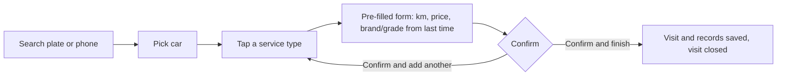
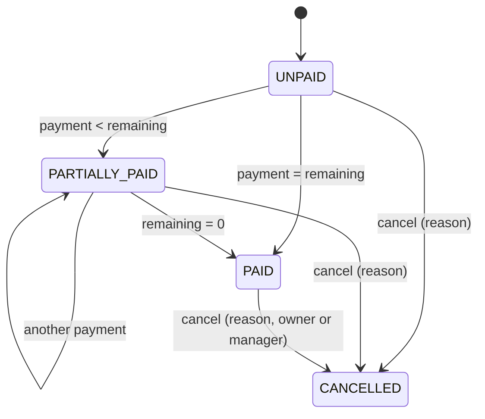
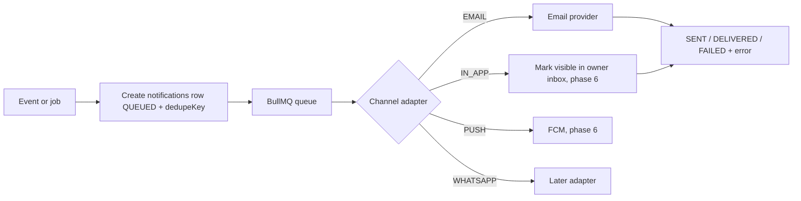
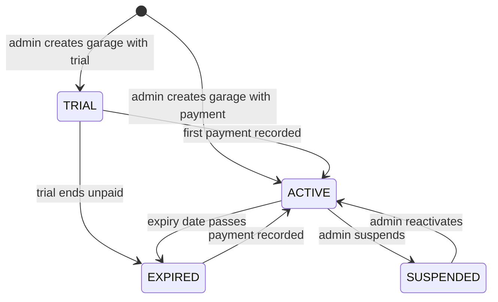

# Gearva — System flows

How the system behaves, step by step. `database.md` defines the tables used here and `README.md` defines the rules and build order. Each section names the roadmap phase that implements it.

---

## 1. Actors and permissions

| Actor | App | How they log in |
|---|---|---|
| Super admin / admin | V2 `admin` | Email + password, plus a TOTP code if the admin turned on 2FA (optional, recommended) |
| Garage OWNER | V1 `garage-web` | Email + password (invite link sets the password) |
| MANAGER, MECHANIC, RECEPTIONIST | V1 `garage-web` | Email + password |
| Car owner (customer) | V3 owner app (Flutter) | Email + password, set through an invite link from their garage (section 2.4) |
| System | background jobs | n/a |

### Garage permission matrix (V1)

| Action | OWNER | MANAGER | MECHANIC | RECEPTIONIST |
|---|---|---|---|---|
| Add / edit customers and vehicles | yes | yes | yes | yes |
| Quick entry, create visits and service records | yes | yes | yes | no |
| Finish visit (creates invoice) | yes | yes | yes | no |
| Record a payment later | yes | yes | no | yes |
| Record a payment while finishing a visit | yes | yes | yes | n/a (cannot finish) |
| Edit an invoice the same day | yes | yes | yes (own visits) | no |
| Edit an invoice after the same day | yes | no | no | no |
| Cancel an invoice | yes | yes | no | no |
| See income summary, revenue screens, debt list | yes | yes | no | debt list only |
| Reminders due list (send on WhatsApp, section 9.5) | yes | yes | no | yes |
| Notification log | yes | yes | no | no |
| Offers and broadcasts | yes | yes | no | no |
| Staff, garage settings, branch name/address/phone | yes | no | no | no |
| Reminder settings (lead km and days, monthly reminder): set by Gearva, section 9.5 | no | no | no | no |
| Add a branch, switch a branch on or off (Gearva super admin only, section 11.7) | no | no | no | no |
| Switch branch view (all branches) | yes | yes | no, own branch only | no, own branch only |

This matrix is enforced by a `RolesGuard` in the API. The web app hides what a role cannot use, but the API is the real check.

---

## 2. Access and accounts (Phase 1)

### 2.1 Admin creates a garage
1. Admin opens "New garage" in V2 and enters business name, email, phone, location text, and either ticks a free trial (30 days) or enters a **paid-until date** (required when there is no trial).
2. API (`POST /admin/v1/garages`), in one transaction, creates: `garages` row (`status = TRIAL` with `trialEndsAt`, or `status = ACTIVE` with `isPaid = true` and `expiresAt` = the paid-until date), `garage_settings` with defaults, one main `branches` row (`code = BR1`), and one `users` row with `role = OWNER`, no password yet.
3. API generates a single-use invite token (stored hashed, expires in 7 days) and queues an `INVITE` email to the garage's email with a link to `gearva.online/set-password?token=...`.
4. The owner opens the link, sets a password, and is logged in.
5. Admin can regenerate the invite or trigger a password reset from V2 at any time.

Details (Phase 1, step 1.5):
- The garage email is also the owner's login email (`users.email` is globally unique, so an email that is already a login is refused with `EMAIL_ALREADY_USED` and nothing is created). The admin also enters the owner's name.
- Trial: `trialEndsAt = now + 30 days` (constant until `trial.days` exists in Phase 5). Paid: the admin picks the last paid day; `expiresAt` is the end of that day (UTC).
- Main branch: `code = BR1`, named after the garage.
- Links: the invite lasts 7 days; a password reset lasts 24 hours. Both are `gearva.online/set-password?token=...` and share `users.inviteTokenHash` (only the token's SHA-256 is stored); a new link replaces the previous one. Resend invite only while the owner has no password (`OWNER_ALREADY_ACTIVE`), reset only after (`OWNER_NOT_ACTIVATED`).
- Endpoints: `POST /admin/v1/garages`, `GET /admin/v1/garages` (`q`, `status`, pagination), `GET /admin/v1/garages/:garageId`, `POST .../:garageId/invite`, `.../password-reset`, `.../suspend` (reason required), `.../reactivate` (back to `TRIAL` if unpaid with a trial, else `ACTIVE`). Each mutation writes an audit row with the garage id.

### 2.2 Login (garage staff)
1. `POST /v1/auth/login` with email and password.
2. Auth looks up the user by email (platform DB role), checks `isActive`, verifies the argon2 hash, and loads the garage.
3. If the garage is `SUSPENDED` or expired, return `GARAGE_LOCKED` (the web app shows a lock screen with the garage's renewal message).
4. Otherwise create a session, set httpOnly access (15 min) and refresh (30 days, rotated) cookies, host-only on `gearva.online` through the app's API forwarding (README 5.2).
5. Login attempts are rate limited per IP and per email.

Details (Phase 1, step 1.6):
- **Set password** (`POST /v1/auth/set-password` with `token` and `password`, at least 10 characters): the invite and the reset link both land here. The link must be unused and not expired (else `INVALID_LINK`). The password is saved, the link is cleared, every other session of that user is ended, and the user is signed in, unless the garage is locked (`GARAGE_LOCKED`; the password stays set).
- Other endpoints: `POST /v1/auth/refresh` (rotation, as for admins; refused with `GARAGE_LOCKED` when locked), `POST /v1/auth/logout`, `GET /v1/auth/me` (the user and their garage). Login and set-password update `users.lastLoginAt` and `garages.lastLoginAt`, and write a `user.login` / `user.set_password` audit row.
- Staff have no 2FA. The per-email lockout (10 failures, 15 minutes) is separate from the admin one.

Garage web app (step 1.6b):
- English is the default language (decision 2026-10-21) and the browser's language is ignored. Every screen has a switch to Arabic (right-to-left) and back. The choice is remembered on that device for a year (cookie `gv_locale`), so a link without `/en` or `/ar` (such as the invite link `/set-password?token=...` or a bookmark) opens in the language the person last chose, and in English if they never chose.
- Pages: `/login`, `/set-password?token=...` (password typed twice; signs the person in), the signed-in home page, and for the OWNER only `/settings/branches` and `/settings/staff`. Other roles see only the home page until Phase 2.
- There is no "forgot password" self-service: staff ask the owner for a reset link; the owner asks Gearva (admin, section 2.1).
- Any answer `GARAGE_LOCKED` (at login, set-password, refresh or mid-session) replaces the app with the lock screen for `details.reason`, with "Try again" and "Sign out".

### 2.3 Admin login
Same as above. **Two-factor authentication (TOTP) is optional per admin** (decision 2026-10-21): an admin without it signs in with the password alone; an admin who turned it on also needs a code (or a recovery code), and the session is only issued after both. It is recommended for every admin, because the admin account can create, suspend and reset every garage. Admin cookies are scoped to `admin.gearva.online` only.

1. `POST /admin/v1/auth/login` (email, password).
   - 2FA off: the session cookies are set at once and the answer is `{ next: "DONE", admin }`.
   - 2FA on: a 5-minute challenge cookie is set and the answer is `{ next: "TOTP_VERIFY" }`. No session yet.
2. 2FA on: `POST /admin/v1/auth/totp/verify` with `code` (6 digits) or `recoveryCode` opens the session. Each recovery code works once.
3. Every completed login writes one `admin.login` audit row.
4. Turning 2FA on (signed in, Account page): `POST /admin/v1/auth/totp/setup` returns a new secret as an `otpauth://` URI (shown as a QR code) and as text; `POST /admin/v1/auth/totp/enable` with one correct code turns it on and returns 10 recovery codes **once**.
5. Turning 2FA off (signed in): `POST /admin/v1/auth/totp/disable` with a current code or a recovery code. The secret and recovery codes are deleted.
6. `POST /admin/v1/auth/refresh` rotates the refresh token; `POST /admin/v1/auth/logout` revokes it; `GET /admin/v1/auth/me` returns the signed-in admin (including `totpEnabled`).
7. 10 failed password or 2FA attempts for one email lock it for 15 minutes, on top of the per-IP limit.

### 2.4 Owner (customer) login on mobile (Phase 6)
**Decided 2026-10-29 and 2026-11-15 (user):** owners log in with an **email and password**, which they set themselves through an invite link from their garage; not phone + one-time code. The full API is in `docs/mobile-api.md` (section 2).

1. **Invite.** Staff (OWNER, MANAGER, RECEPTIONIST) open a customer who has an email (`garage_customers.email`) and tap **Invite to the app**. The API, in one transaction: refuses if the person already has an active app account (`OWNER_APP_ALREADY_ACTIVE`: their cars from this garage already appear in their app); refuses if another owner already uses that email for the app (`EMAIL_ALREADY_USED`); else sets `owners.email`, stores a hashed one-time token (7 days, a new invite replaces the old one), sets `garage_customers.inviteSentAt`, writes an audit row, and queues an `INVITE` email (template `owner-invite`) with the link `gearva.online/owner/set-password?token=...`.
2. **Set password.** The web page checks the token, takes a password (10+ characters), stores its argon2id hash and ends the token. It then says to download the app.
3. **Log in.** In the app, email + password. The API returns a 15-minute access token and a 30-day refresh token (Bearer, not cookies: a native app has no cookie jar to protect), for `SubjectType.OWNER`. A refresh token works once; reusing one ends all of the owner's sessions, as for staff and admins (README 5.2; sessions are not tracked per device). Same error for a wrong password, an unknown email and an account without a password.
4. **Forgot password.** Always answers the same, whether or not the email has an account; if it has one, a reset link (24 hours) to the same page.
5. **Several garages.** The owner is one person (`owners`, by phone). A second garage's invite to someone who already has an account sends nothing; their cars there simply appear. Each garage sees only its own records; only the owner app shows them together.
6. **Delete account.** The owner can delete their app account in the app (the stores require it): the email, password hash, sessions and device tokens are removed; the garages keep their own records.
7. **A locked garage** (subscription ended, 2.5): its customers still see their history and invoices from it in the app (read only); its offers are hidden and it sends no reminders.

Details (step 6.1):
- Invite: `POST /v1/customers/:customerId/app-invite` (OWNER, MANAGER, RECEPTIONIST; 10 per minute), answering the customer with `appStatus` and `inviteSentAt`. The email is the customer's `garage_customers.email`; without one the answer is `CUSTOMER_EMAIL_REQUIRED`. The owner row is changed through `invite_owner()` (database.md 6.6). The email (template `owner-invite`) is sent at once (the daytime rule is only for reminders) in the owner's language, with the link `gearva.online/<ar|en>/owner/set-password?token=...`. "Send again" replaces the link. Audit action `customer.app_invite`.
- The customer page shows the app status: `NONE`, `INVITED` (this garage sent an invite, with the date) or `ACTIVE` (the person set a password, from any garage's invite). It never shows the login email, which another garage may have set.
- Set password: the page posts to `POST /mobile/v1/auth/set-password` (`token`, `password`), forwarded by garage-web like `/v1`. It answers `{ email }` and signs nobody in; the page then says to download the app and sign in with that email. A used, replaced or expired link gives `INVALID_LINK`. It ends every app session of that owner, and writes an `owner.set_password` audit row (actor `OWNER`, no garage).
- The privacy policy is public at `gearva.online/privacy` (English and Arabic), linked from the website footer and the set-password page. The stores need its address for the app.
- The WhatsApp invite recorded when a customer is added (section 3.1 step 5) stays as it is.

Details (step 6.2):
- Every `/mobile/v1` route goes through a global `OwnerGuard` (like `StaffGuard` for `/v1`, chosen by the controller's declared path): a Bearer access token of type `owner`, an open session, and an owner whose app account still exists. Only the `auth/*` routes are public. A locked garage blocks nothing here (step 7).
- The owner's requests read garage tables through `OwnerDb` (database.md 6.4): `app.owner_id` is set, `app.garage_id` is not. Changes to the account itself (language, password, deletion) go through the platform role, like the login.
- Login failures count per email as for staff (10, then 15 minutes), on top of 10 per minute per IP. Changing the password or deleting the account needs the current password and counts the same way.
- Forgot password: one email per address per minute. The notification row belongs to the garage whose invite set the login email (the latest successful invite), so no garage's log shows an email another garage entered. It uses the `password-reset` template and the owner set-password page.
- Changing the password keeps the current session and ends the others. Deleting the account clears the email, password, link and `passwordSetAt` and ends every session; the garage then sees the customer as `INVITED` again (its earlier invite date) and may invite them again.
- Step 6.3, reading: cars, history, invoices, PDFs and logos go through `OwnerDb` and the `owner_read` policies, and the code filters by owner too. A car or invoice shows while the person is a live customer of a garage that exists; a locked garage still shows. The next-service status uses the reminder scan's rule (`nextServiceStatus` in `contracts`, next to `reminderRound`), with the garage's lead km and days, so the app and the reminders agree. Service names and detail labels follow `Accept-Language`, else the owner's language. A PDF that is not ready is queued for the invoice's garage and answers `INVOICE_PDF_NOT_READY`. Reading writes no audit rows (README 5.6: mutations only).
- Audit actions (actor `OWNER`, no garage): `owner.login`, `owner.session.refresh`, `owner.logout`, `owner.update`, `owner.change_password`, `owner.delete_account`; `owner.preferences` carries the garage. A forgot-password request has no actor and writes no row.

### 2.5 Subscription lock
Every garage request passes this check after authentication:

```
if garage.status == SUSPENDED            -> 403 GARAGE_LOCKED (reason: suspended)
if garage.status == EXPIRED              -> 403 GARAGE_LOCKED (reason: expired)
if garage.expiresAt < now                -> 403 GARAGE_LOCKED (reason: expired)
if garage.status == TRIAL and trialEndsAt < now and not paid -> 403 GARAGE_LOCKED (reason: trial_ended)
else continue
```

Implementation (step 1.6): the rule is one function (`apps/api/src/common/garage-lock.ts`), used by staff login, set-password, refresh and `StaffGuard`. `StaffGuard` is a **global** guard for every route of a `v1/...` controller (chosen by the controller's declared path, not the URL text, because routing ignores letter case): it checks the staff session, then this lock, then the role from `@Roles(...)` (section 1), then sets the tenant context (section 2.6). Only login, set-password, refresh and logout are marked `@Public()`, so a new endpoint cannot skip the lock or the tenant context by accident. The reason is sent as `details.reason`, so the web app can show the right lock screen. A lock never deletes anything; sessions stay valid and work again as soon as the garage is unlocked. A refresh refused with `GARAGE_LOCKED` therefore keeps the session cookies (every other refused refresh clears them).

An `ACTIVE` garage always has an `expiresAt` (set at creation in Phase 1, by subscription payments from Phase 5), so it can never stay unlocked forever. An hourly job (step 5.2, `GarageExpiryService`) also sets `status = EXPIRED` for garages whose `expiresAt` passed, or whose unpaid trial ended, so lists in V2 are accurate; a suspended garage keeps its status. An unpaid trial marked `EXPIRED` still shows the reason `trial_ended`. When the admin records a payment (section 11), the status returns to `ACTIVE` and the garage works again immediately.

### 2.6 Tenant context on every request
```mermaid
sequenceDiagram
  participant C as Client
  participant G as Guards
  participant S as Service
  participant DB as Postgres (RLS)
  C->>G: request + cookie
  G->>G: verify JWT, load user + garage
  G->>G: GarageActiveGuard, RolesGuard
  G->>S: tenant context {garageId, userId, role, branchId}
  S->>DB: BEGIN; set_config('app.garage_id', garageId, true)
  S->>DB: queries (filtered by code AND by RLS)
  DB-->>S: only this garage's rows
  S-->>C: response (audit row written for mutations)
```

---

## 3. Customers and vehicles (Phase 2)

### 3.1 Add a customer
1. Staff enters name and phone number.
2. API normalizes the phone to E.164.
3. Find or create the global `owners` row by phone (name and the garage's default locale are used only if it is new).
4. Find or create the `garage_customers` link for (garage, owner). If it already exists, return the existing customer instead of creating a duplicate.
5. Queue an `INVITE` notification so the customer can download the app. It is a WhatsApp row (template `customer-app-invite`), logged as `SKIPPED` until WhatsApp is available. The email invite with the set-password link is sent from the customer page with **Invite to the app** (section 2.4, step 6.1), once the customer has an email.

**Same phone at two garages:** both garages link to the same `owners` row. Each garage sees only its own `garage_customers`, vehicles, visits and invoices (RLS). The owner app (phase 6) sees both histories through `ownerId`.

API (step 2.3): `POST /v1/customers` `{ name, phone, notes? }` answers **201** with the new customer, or **200** with the existing one when this garage already has the phone (`created: false`; name and notes are left unchanged). The phone may be typed in any format; it is stored in E.164 (a number without a country code is read as Lebanese). Staff enter no email in Phase 2, so the app invite of step 5 is recorded for WhatsApp (`customer-app-invite`) and logged as `SKIPPED`. Phase 4 adds an optional `email` to the customer (`garage_customers.email`, the garage's own contact data, decision 2026-11-05), used for reminders (section 9). The app invite stays as it is until the owner app exists (Phase 6). API (step 4.4): `email` is optional on `POST` and `PATCH /v1/customers`, stored lower case; an empty value clears it. Adding a phone the garage already has leaves the email unchanged, like the name. `GET /v1/customers` (every role, decision 2026-10-27: newest first, paginated, max 50 per page, 60 requests per minute, optional `q` matching the name or the end of the phone; no export, README 5.4), `GET /v1/customers/:id` (with the cars; writes a `customer.view` audit row, section 12) and `PATCH /v1/customers/:id` (name, notes, opt-outs; the phone is the owner's identity and does not change here). All four roles may use them.

### 3.2 Add a vehicle
1. Staff enters plate, make, model, year, current odometer, and chooses the display unit (KM or MI).
2. Odometer is converted to km and stored in `vehicles.currentKm`.
3. Make and model go through `suggestions` (section 4.3).
4. Plate uniqueness is checked per garage on `plateNormalized`. If the plate exists for another customer, show the existing car instead of failing silently.

API (step 2.3): `POST /v1/customers/:customerId/vehicles` `{ plate, make, model, year?, distanceUnit, odometer, notes? }`. A plate already used in this garage (any spelling: `b 123-456` = `B123456`) answers **409 `VEHICLE_PLATE_EXISTS`** with the existing car and its customer in `details`. `GET /v1/vehicles/:id` returns the car with its customer and today's `estimatedKm` (section 5.2) and writes a `vehicle.view` audit row; `PATCH /v1/vehicles/:id` edits plate, make, model, year, unit and notes. The odometer changes only through visits (section 4), never by editing the car.

### 3.2.1 Add another car to an existing customer
A customer can have any number of cars (no limit in the schema).
1. Open the customer (or find them by phone in search) and tap "Add car". The same form as above opens with the customer already fixed, so no name or phone is asked again.
2. The new `vehicles` row gets the same `garageCustomerId` and `ownerId`. Each car has its own unit (KM or MI), odometer, average daily usage, history and reminders.
3. Searching by phone returns **all** the customer's cars, so the mechanic taps the right one. Searching by plate goes straight to that car.
4. In quick entry, if the customer exists but the car does not, "Add new" asks only for the car fields (plate, make, model, year, odometer) and returns to the service step.
5. In the owner mobile app, all of the owner's cars at that garage (and at other garages) are listed.

### 3.3 Search
One search box accepts a plate or a phone number. Search matches `plateNormalized` prefix or the phone suffix, always inside the garage, always paginated (max 50), always rate limited. Results show customer, plate, make/model.

API (step 2.3): `GET /v1/search?q=` (2 to 40 characters, `page`, `pageSize`, 60 requests per minute per IP). The text is normalized like a plate and matched as a prefix; when it looks like a phone (only digits, spaces and `+ - ( ) .`, at least 4 digits) its digits without leading zeros are also matched as the end of the owner's phone, so `03 123 456` finds `+9613123456`. One row per car; a matching customer with no car comes back once with `vehicle: null` so staff can add one.

Garage web (step 2.5): the home page is this search for every role, with results as you type (from 2 characters). A "Customers" page in the header lists all customers (paginated, with a name or phone filter). A result opens the car, or the customer when they have no car yet. "Add customer" carries a phone-looking search text into the form; a phone the garage already has opens that customer's file with a note. The car page shows today's estimated odometer and the service history (newest first).


---

## 4. Quick entry and visits (Phase 2)

**Target: under 20 seconds from search to saved.** Required input is only: the car, the service type, and a confirm. Everything else is pre-filled or hidden under "More details".

### 4.1 Flow


1. Staff searches and taps the car. If the customer or car does not exist, "Add new" opens the minimal form (name, phone, plate, make, model) and returns to this step.
2. Staff taps the service type (oil change, brakes, ...). For `OTHER`, they type a custom name (autocomplete from `SERVICE_NAME` suggestions).
3. The form opens **pre-filled**:
   - date and time = now
   - mechanic = logged-in user, branch = user's branch
   - odometer = estimated current km (section 5) as a suggestion the mechanic corrects
   - brand, grade, filter brand etc. = the values from the last record of the same service type on this car ("last used for this car")
   - next change = default interval for the service type (section 6)
4. Staff fixes the odometer, enters price and quantity, then taps **Confirm and finish** (one visit with that service, closed as `DONE`; from Phase 3 this also issues the invoice) or **Confirm and add another** (keeps the visit open). In the web app, **Confirm and finish** saves the service, then opens the finish step (section 7.1) on the visit page; the visit closes and the invoice is issued when that step is confirmed.
5. "More details" (collapsed): labor and parts split, warranty, photos, status, recommended next service, notes.

Garage web (step 2.6): search → tap the car → tap a service button on the car page (owner, manager, mechanic) → the pre-filled form → **Confirm and finish** (the "Paid now?" step, then the visit summary with the next due values and the invoice) or **Confirm and add another** (the visit stays open; its page offers the service buttons again, "Waiting for parts" and **Finish visit**). The odometer starts at today's estimate; the next due km follows it as it is typed. Price is typed in dollars and turned into cents as text, never through a float. An unusual odometer shows "Is this right?" with **Yes, save** (sent again with `confirmOdometer`) or **Fix it**. Photos are not in Phase 2 (files arrive in Phase 3).

### 4.2 API behavior
- `POST /v1/visits/quick` accepts `{ vehicleId, odometer, odometerUnit, services: [...], finish: boolean }` and creates visit, records and reminders in **one transaction**; with `finish` the visit is also closed (`DONE`, `finishedAt` set). `finish` also creates the invoice (section 7.1) in that same transaction, so the request also takes the finish options: `discount`, `confirmFree` and `payment`.
- For longer jobs: `POST /v1/visits` (opens `IN_PROGRESS`), `POST /v1/visits/:id/records`, `PATCH /v1/visits/:id` (status), `POST /v1/visits/:id/finish`.
- **Phase split (decision 2026-10-23):** invoices are Phase 3, so in Phase 2 "finish" (quick entry or `POST /v1/visits/:id/finish`) only closes the visit. Phase 3 adds the invoice to the same action; visits finished during Phase 2 development simply have no invoice.
- **Implemented in step 2.4 (2026-10-26):**
  - `GET /v1/service-types` lists one type per code, the garage's override instead of the global default. `GET /v1/vehicles/:id/prefill?serviceTypeId=` returns the estimated odometer (km and the car's unit), the "last used for this car" values (latest record of the same service code) and the next due values if done today.
  - A service line needs only `serviceTypeId`; `quantity` defaults to 1 (at most 2 decimals), `unitPriceCents` to 0 (flow.md 13). `details` must match the type's `detailKey` (database.md 4.4); a type without one takes no details. `OTHER` needs `customName`. `nextDueOdometer` (in the car's unit) and `nextDueDate` replace the computed values; `null` removes them.
  - **Branch:** staff bound to a branch (mechanic, receptionist) always record in their own branch; another `branchId` is refused (`FORBIDDEN`). Owners and managers may pass `branchId`; the default is the main branch. An inactive branch is refused (`BRANCH_INACTIVE`).
  - **Odometer:** a reading lower than the car's last one or more than 5,000 km per day answers `409 ODOMETER_CONFIRMATION_REQUIRED` with `details.check` (`CORRECTION` or `TYPO`); repeating the request with `confirmOdometer` set to that value saves it. A confirmed correction writes a `vehicle.odometer_correction` audit row (before and after km). Every visit sets the car's `currentKm`, `lastOdometerAt` and `avgDailyKm` (section 5.1).
  - **Roles (section 1):** OWNER, MANAGER and MECHANIC create visits and records and finish visits; a RECEPTIONIST can read visits and history but not create or change them. Staff bound to a branch see only that branch's visits; a car's history (`GET /v1/vehicles/:id/history`, newest first, paginated) shows every branch.
  - Finishing locks the visit row (`SELECT … FOR UPDATE`): a second finish gets `VISIT_ALREADY_FINISHED`; a visit without records gets `VISIT_HAS_NO_RECORDS`. A finished visit takes no more records or status changes. `PATCH` sets only `IN_PROGRESS` or `WAITING_FOR_PARTS`; `DONE` comes only from finishing.

### 4.3 Smart suggestions
- When a field with a suggestion list gets focus or typing, the web app calls `GET /v1/suggestions?field=OIL_BRAND&q=cas`. The API returns matches on `valueNormalized` prefix, ordered by `useCount DESC`.
- Tapping a suggestion fills the field.
- On save, every suggestion-backed value is upserted: new values are created, existing ones increment `useCount` and update `lastUsedAt`. The normalized form (lowercase, trimmed) prevents "Castrol" vs "castrol" duplicates; the display value keeps the first spelling used.
- Lists are per garage and never shared.
- API (step 2.3): `GET /v1/suggestions?field=&q=` returns at most 10 values (`{ items: [{ value, useCount }] }`); an empty `q` returns the most used. Saving a car records its make and model.

### 4.4 Visit status
`IN_PROGRESS` and `WAITING_FOR_PARTS` keep the visit open (no invoice yet). `DONE` plus "Finish visit" closes it (and, from Phase 3, issues the invoice). Moving a visit to `DONE` queues a `CAR_READY` notification to the owner (email or in-app now). Until owners have an email or the app, it is recorded for WhatsApp (template `car-ready`) and logged `SKIPPED` (step 2.4).

---

## 5. Odometer, average daily usage and estimated km (Phase 2)

All values in km internally.

### 5.1 Average daily usage
Recalculated after every saved visit for that vehicle:

```
readings = last 5 odometer readings for the vehicle (one per visit: visits.odometerKm with openedAt, plus the car's reading before this visit, so a car added without history gets an average at its first visit), oldest to newest
a reading lower than the one before it is a confirmed correction (5.3): start again from it, so only it and later readings count
if fewer than 2 valid readings:
    avgDailyKm = null     (the estimate falls back to garage_settings.defaultDailyKm, else system default 35)
else:
    avgDailyKm = (lastKm - firstKm) / max(1, days between first and last)
clamp avgDailyKm to the range 5..300 per day, rounded to 2 decimals
```

Step 2.2 (2026-10-26): the earlier text said to *drop* a lower reading, which disagreed with 5.3 ("resets from that point"). After an odometer is replaced every new reading is lower than the old ones, so dropping them would freeze the average on the old odometer; the calculation now starts again from the correction. Implemented in `packages/contracts/src/odometer.ts` (`averageDailyKm`).

### 5.2 Estimated current km
```
daysSince = whole days between vehicles.lastOdometerAt and now (never negative)
estimatedKm = vehicles.currentKm + round((avgDailyKm ?? garage defaultDailyKm ?? 35) * daysSince)
```

Used for: the pre-filled odometer in quick entry, and the reminder scan (section 9.1).

### 5.3 Rules
- A new odometer lower than the last recorded one is allowed only after a confirmation ("odometer correction"), is audit logged, and resets `avgDailyKm` calculation from that point.
- A jump of more than 5,000 km per day since the last reading (days counted as at least 1) is flagged as a likely typo and needs confirmation (`checkOdometer` answers `OK`, `CORRECTION` or `TYPO`).
- Display uses the vehicle's unit: `miles = round(km / 1.609344)`. Entry in miles is converted with `round(miles x 1.609344)`.

---

## 6. Next-change logic (Phase 2)

On saving a `service_record`:

```
interval = garage override for this service type
           ?? global default for this service type
intervalKm   = (vehicle uses KM) ? interval.defaultIntervalKm : interval.defaultIntervalMi converted to km
intervalMonths = interval.defaultIntervalMonths

nextDueKm   = intervalKm   ? odometerKm + intervalKm : null
nextDueDate = intervalMonths ? (performedAt as a date in the garage's time zone) + intervalMonths months : null
             (the day is kept, or clamped to the month's last day: Aug 31 + 6 months = Feb 28)
```

Example: a car on KM, oil change at 5,500 km, default 5,000 km: `nextDueKm = 10,500`. For a car on MI with interval 3,600 mi at 3,417 mi: next at 7,017 mi, stored as km.

- The mechanic can edit the interval or the next due value in the form (km and miles are separate editable defaults).
- Each service type has its own interval (brakes, battery, gear oil do not follow the oil cycle).
- The date is a **time fallback**: if the customer drives little, the reminder still fires when the date arrives.
- Saving a record creates or replaces the reminder automatically:
  1. Mark the previous `ACTIVE` or `SENT` `SERVICE_DUE` reminder for the same vehicle and service type as `COMPLETED`. "Same service type" means the same code, so a garage override and the global default are one service. `OTHER` records never complete each other (two different custom services share the code).
  2. Insert a new `ACTIVE` reminder with `nextDueKm` and `nextDueDate`.
  3. If `warrantyUntil` is set, insert a `WARRANTY_END` reminder.
  4. If `recommendedAfterMonths` is set, insert a `RECOMMENDED_NEXT` reminder.

---

## 7. Invoices (Phase 3)

### 7.1 Creating an invoice ("Finish visit")
`POST /v1/visits/:id/finish` with optional `{ discount, confirmFree, payment: { method, amountCents? } }` (no `payment` = pay later; no `amountCents` = the whole total), all in one transaction:

1. Lock the visit row, check it has at least one record and no active invoice.
2. **Allocate the invoice number** (gap-free, per garage + branch + year):
   ```sql
   INSERT INTO invoice_counters (branch_id, year, garage_id, last_number)
   VALUES ($branch, $year, $garage, 1)
   ON CONFLICT (branch_id, year)
   DO UPDATE SET last_number = invoice_counters.last_number + 1
   RETURNING last_number;
   ```
   The row lock serializes concurrent requests. The number is formatted with the garage's `invoiceNumberFormat`, e.g. `BR1-2026-0001`. A format must hold `{BRANCH}`, `{YYYY}` and `{SEQ:n}`; without all three, two invoices could get the same text. If the transaction rolls back, the counter update rolls back too, so no gaps.
3. Copy the records into `invoice_items`, snapshot customer, vehicle and garage header, snapshot the garage terms.
4. Apply the offer or discount if present (section 7.4), compute subtotal, discount, VAT (only if enabled), total, `paidCents = 0`, `remainingCents = total`, status `UNPAID`.
5. Set `visit.finishedAt` and `status = DONE`.
6. Commit, then queue jobs: PDF generation, then (if `autoSendInvoice`) the `INVOICE` notification.

**Paid now? (decision 2026-11-02).** The finish step offers **Paid in full**, **Part** (an amount) or **Pay later**, plus the method (Cash or Whish). A payment entered here is created in the same transaction right after the invoice, which makes it `PAID` or `PARTIALLY_PAID`. Mechanics get this choice too (decision 2026-11-02), because they often take the money when they hand over the car. Nothing is chosen at the start of the step, because a payment cannot be undone. It applies only while finishing: recording a payment later stays with the receptionist, manager and owner. Every payment stores who received it (`receivedById`) and cannot be changed or deleted.

**Free work (decision 2026-11-02).** If the total is 0, the API refuses to finish with `409 INVOICE_TOTAL_ZERO` until the request confirms it, and the screen asks "No price. Save as free?". This stops a forgotten price becoming a numbered invoice that cannot be deleted. A confirmed free invoice is `PAID` straight away, with no `payments` row (a payment must be above 0).

### 7.2 PDF
A BullMQ job renders an HTML template with Puppeteer, in the customer's locale (Arabic RTL or English), using the garage's logo and brand color. The PDF is stored in `files` (`INVOICE_PDF`) and linked as `invoices.pdfFileId`. Contents follow the product spec: garage header, number, date and time, customer, car, line items (service, brand and grade, quantity, unit price, total), labor/parts split if entered, discount and offer, total, paid, remaining, payment method, next service km and date, warranty, terms, optional QR code, footer "Powered by Gearva". The PDF is regenerated when anything it prints changes: an edit, a payment or a cancel. Renders can overlap, so a job saves its file only if the invoice has not changed since it read it; the change that made it old queued a newer render. It is downloaded through `GET /v1/invoices/:id/pdf`, after the role and branch checks; if the job has not finished, the API answers `409 INVOICE_PDF_NOT_READY` and queues it again. The optional QR code and automatic email wait for the features they need (Phase 4 for email). The invoice page in garage-web shows each line's service name in the staff member's language (the API gives both names); the PDF keeps the customer's language, and a custom name shows as typed.

**Invoice settings** (owner; logo, brand colour, number format, terms, VAT) are the **Settings** tab of the Invoices page since step 7.2 (`/invoices?tab=settings`; the old address `/settings/invoices` sends there). Managers and receptionists see only the list.

### 7.3 Statuses


### 7.4 Discounts and offers
- A discount is an amount or a percentage entered on the invoice, and/or an offer picked from the active offers of the garage.
- Choosing an offer stores `invoices.offerId` and applies the offer's discount. That link is how redemptions are counted. A typed discount is built in Phase 3. Picking an offer comes with the offer screens, targeting and broadcasts in Phase 7 (section 10), because no offer can exist before them; the `offers` table and `invoices.offerId` are ready for it.
- The discount is computed in integer cents with documented rounding (round half up) and never makes the total negative.
- VAT, when on, is charged on the amount after the discount, also in integer cents with halves rounding up.

### 7.5 Editing and cancelling
- **Edit window:** same day (garage timezone) the mechanic (own visits) or manager can edit; after that only the OWNER. An edit changes quantities, prices and the discount, and the service records move with their lines. Adding or removing a line is cancel and reissue. A total below what was already paid is refused (`INVOICE_TOTAL_BELOW_PAID`), and a total of 0 needs confirming like at finish. Every edit stores `before` and `after` in `audit_logs`, recalculates totals with the invoice's own VAT rate, regenerates the PDF.
- **No deleting.** To fix a mistake: cancel with a required reason, then create a new invoice from the same visit (`POST /v1/invoices/:id/reissue`, owners and managers). The new invoice gets the next number and `replacesInvoiceId` points to the cancelled one. Money already paid does not move to it: the cancelled invoice stays "refund needed", and the new one starts unpaid unless a payment is entered.
- Cancelled invoices stay in lists, marked clearly, and keep their number. A visit shows its newest invoice, so a cancelled one stays reachable until a new one replaces it. Recorded payments on a cancelled invoice stay in the table and are shown as "refund needed" in the debt/revenue screens (no automatic refund logic).
- Reprinting or re-sending is audit logged.

### 7.6 Delivery
Email PDF (if an email exists), in-app history for the owner (visible in the mobile app), and print from the browser. WhatsApp PDF is added later as one more channel adapter.

---

## 8. Payments and debt (Phase 3)

### 8.1 Recording a payment
`POST /v1/invoices/:id/payments` with amount, method (`CASH` or `WHISH`), date, note. In one transaction:
1. Lock the invoice row. Reject if `CANCELLED` (`INVOICE_CANCELLED`) or the amount exceeds `remainingCents` (`PAYMENT_EXCEEDS_REMAINING`). The date defaults to today; a past day is allowed, a future one is not.
2. Insert the `payments` row.
3. `paidCents += amount`, `remainingCents -= amount`, set status `PARTIALLY_PAID` or `PAID`.
4. Write the audit row.

### 8.2 Debt list
Customers with at least one `UNPAID` or `PARTIALLY_PAID` invoice, with the total remaining per customer and each invoice listed. Optional payment reminder (garage setting, "after X days") sends a `PAYMENT_REMINDER` notification once per invoice per interval.

### 8.3 Income summary (Phase 3, decision 2026-11-02)
For owners and managers: today and this month in the garage's timezone, each showing **received** (`payments` by `paidAt`) and **invoiced** (`invoices` by `issuedAt`, without `CANCELLED`). Payments on a cancelled invoice stay in received, because the money really came in; they also appear as "refund needed" (section 7.5). Branch scoping follows the permission matrix.

### 8.4 Revenue screens (Phase 7)
Income per day, month, year, per service type and per branch, plus total invoiced per customer. Each screen must state whether it shows money **received** (from `payments`) or **invoiced** (from `invoices`). Role and branch scoping apply.

---

## 9. Reminders (Phase 4)

Decisions of 2026-11-05 (user, at the start of Phase 4): until the owner app (Phase 6) and an automatic WhatsApp channel (later) exist, a reminder reaches the customer by **email** when the garage has their email, and otherwise through the **WhatsApp list** (9.5), where staff send it from their own WhatsApp in one tap. The monthly reminder is **off by default** (9.2).

### 9.1 Reminder scan
A BullMQ repeatable job runs **every hour**. It lists the active garages with `gearva_platform`, then processes each garage under its own tenant context, but only while the garage's local time is inside the daytime window (9.3). Running hourly instead of once a day at a fixed time handles every garage's time zone, and catches up after a restart; the dedupe keys make running it again harmless.

A reminder is **due** when:

```
reminder.status is ACTIVE, or SENT with a follow-up due:
    status SENT and notifyCount < 1 + REMINDER_FOLLOW_UPS (2)
    and lastNotifiedAt <= now - REMINDER_FOLLOW_UP_DAYS (30)
garage_customer.remindersOptOut is false (and the customer is not deleted)
estimatedKm = estimate for the vehicle (section 5.2)
dueByKm   = nextDueKm   != null and estimatedKm >= nextDueKm   - reminderLeadKm
dueByDate = nextDueDate != null and today       >= nextDueDate - reminderLeadDays
dueByKm or dueByDate
```

`today` is the date in the garage's time zone. `WARRANTY_END` and `RECOMMENDED_NEXT` reminders have only a date, so they are due by date, and are sent once: follow-ups are for service reminders only (step 4.3). Implemented as `reminderRound` in `packages/contracts/src/reminders.ts`; a warranty end is logged with type `WARRANTY_END`, a recommended service with `SERVICE_REMINDER`.

For each due reminder, one **round** (`notifyCount + 1`) is sent once:
- **The customer has an email** (`garage_customers.email`): the scan records an `EMAIL` notification with `dedupeKey = REMINDER:{reminderId}:{round}:EMAIL` and queues it.
- **No email, or the email of this round ended `FAILED` or `SKIPPED`:** nothing is sent automatically; the reminder appears on the WhatsApp list (9.5).

When a round is sent (the email is `SENT`, or staff mark the WhatsApp message sent), in the same transaction: `notifyCount += 1`, `lastNotifiedAt = now`, status `SENT`. When the customer services the car, the reminder is `COMPLETED` (section 6), and a reminder that was never sent leaves the list.

- Message: "Kindly check your km, your next change is at [number]." (in the customer's language, the number in the car's unit), with the garage's name. Warranty and recommended-next reminders have their own text.
- The settings in capitals are constants in `contracts` until `system_settings` exists (Phase 5), like the default daily km (README 7).

### 9.2 Monthly reminder
A garage setting, `garage_settings.monthlyReminderEnabled`, **off by default** (decision 2026-11-05: avoids customers feeling spammed). When it is on (set by Gearva on the garage's admin page since step 7.4), the scan sends, once a month, a general reminder by email to every customer of the garage that has an email and has not opted out (dedupe key `MONTHLY_REMINDER:{garageCustomerId}:{YYYY-MM}`). It is skipped for a customer who already received a reminder that month. It is never put on the WhatsApp list.

### 9.3 Sending rules
- **Daytime only** in the garage's time zone, from `REMINDER_DAYTIME_START` (09:00) to `REMINDER_DAYTIME_END` (20:00). The scan runs only inside the window, and a reminder email whose sending or retry falls outside it is delayed to the next window, never sent at night. Invoices, invites and password resets are not reminders and are sent at once.
- **No duplicates:** the unique `(garageId, dedupeKey)` constraint is the real guard. The code also checks the log first.
- **Fair-use cap:** automatic reminder emails per garage per month, `REMINDER_MAX_PER_GARAGE_PER_MONTH` (a constant until the real cap is set in Phase 5, README 7). Over the cap, notifications are `SKIPPED` with a reason, so those reminders move to the WhatsApp list, and the admin sees it in monitoring (Phase 5). Messages staff send themselves on WhatsApp cost nothing and do not count.
- **Warranty and recommended-next reminders** use the same pipeline with their own templates.

### 9.4 Notification pipeline


- Retries with exponential backoff for transient failures (3 attempts in all), then `FAILED` with the error text.
- A row still `QUEUED` some minutes after it was written (Redis was down when it was queued, README 9) is queued again by the hourly scan. The job id is the notification id, so a row is never queued twice.
- The **notification log** screen in V1 (OWNER and MANAGER) shows what was sent, on which channel, to whom, and whether it was sent or failed, with the error. It never shows `payload` (database.md 4.6).
- Owner channel order for now: `EMAIL` (if the garage has it), else the WhatsApp list. `IN_APP` and `PUSH` come with the owner app in Phase 6, and an automatic `WHATSAPP` adapter later, without touching the callers.

### 9.5 WhatsApp list

**In garage-web (step 7.3):** one **Reminders** page with two tabs: **To send** (this list; owner, managers, receptionists) and **Message log** (section 9.4; owner and managers, so receptionists see no tabs). `/reminders?tab=log` opens the log, and the old `/notifications` address sends there.

A "Reminders due" screen for OWNER, MANAGER and RECEPTIONIST lists the due reminders (9.1) that this round has not reached by email: customer, car, plate, service, due km or date, and the number of earlier reminders.
- **Send on WhatsApp** opens `https://wa.me/<phone>?text=<message>` with the reminder text already written in the customer's language. Staff press send in WhatsApp.
- **Mark as sent** then records a `WHATSAPP` notification with status `SENT`, `dedupeKey = REMINDER:{reminderId}:{round}:WHATSAPP` and the phone as recipient, and counts the round (9.1). The audit row records who sent it. Gearva cannot see whether the message was really sent; it trusts the button.
- A customer who does not want reminders is marked "No reminders" on their page (`remindersOptOut`) and leaves the list.
- API (step 4.4): `GET /v1/reminders/due` (paginated; each item has the round, the service in both languages, the due km or date, the estimated km, `emailFailed` and the ready `whatsappUrl`) and `POST /v1/reminders/:reminderId/whatsapp-sent` `{ round }`. Marking a round that is already counted answers `counted: false` and changes nothing; a round that is not the next one is `409 REMINDER_NOT_DUE`. The log is `GET /v1/notifications` (filters `status`, `channel`), and the reminder settings (lead km 0–5,000, lead days 0–60, monthly reminder) are `GET` / `PATCH /admin/v1/garages/:garageId/reminder-settings` since step 7.4 (user decision 2026-11-21: Gearva sets them per garage; any admin reads, super admins change; audit `admin.reminder_settings.update` with the garage). The garage's own `/v1/reminder-settings` and its page are removed; `/settings/reminders` sends to Reminders. The admin's garage page explains each setting with a live example, and lists the rules shared by every garage (section 9.3, from Settings).

### 9.6 Owner app inbox and push (step 6.4)
- When a due reminder's customer uses the owner app (the person has a password), the scan also records an `IN_APP` notification: the same type, template name and data as the email, the owner id as recipient, `refType = vehicle` (the screen the app opens), `dedupeKey = REMINDER:{reminderId}:{round}:IN_APP`. It does **not** count the round: the round is still counted by the email or by "Mark as sent" (9.5), so the WhatsApp list works as before, and the app gets one entry per round.
- The `IN_APP` adapter delivers by making the row visible in the inbox (`SENT`) and pushing it to each of the owner's phones through Firebase Cloud Messaging (HTTP v1, `FCM_SERVICE_ACCOUNT_JSON`). Reminder types follow the daytime rule (9.3), so no push arrives at night; they do not count toward the monthly email cap. A push failure does not fail the inbox entry; a dead token is deleted. Without the key there is no push and the inbox still works.
- Titles and bodies are short texts (`templates/in-app.ts`) rendered in the row's language when the inbox is read. The monthly reminder (9.2) stays email only.
- A test push to one phone: `npm run push:test -w @gearva/api -- <token>` (after a build, with the key in the environment).

---

## 10. Offers and marketing (Phase 7)

1. Garage creates an offer: title, text, image (optional), discount type and value, optional expiry, target (`ALL`, `OVERDUE`, or `INACTIVE_6M`).
2. The offer appears in the owner mobile app for customers of that garage.
3. **Broadcast:** the API resolves the target audience with an explicit query (overdue = customers with a `SERVICE_DUE` reminder past due; inactive = no visit in 6 months), excludes `marketingOptOut`, then queues one `OFFER` notification per customer (dedupe key `OFFER:{offerId}:{ownerId}`). Counts against the fair-use cap.
4. The garage picks the offer on an invoice, which applies the discount and stores `offerId`.
5. Offer report: sent, viewed (in-app), redeemed (`COUNT` of invoices with that `offerId`).

Built in step 6.5 (decision 2026-11-15: steps 1, 2 and the "viewed" count moved here from Phase 7):
- Garage app, **Offers** page (OWNER, MANAGER): create and edit an offer (title, text, percent 1–100 or an amount in dollars, start day, optional end day, on/off) and a PNG or JPEG image (2 MB), previewed when picked and uploaded with Save; each card in the list shows its image. Each offer shows its state (`ACTIVE`, `SCHEDULED`, `ENDED`, `OFF`, from `offerState` in `contracts`) and how many app users opened it. Offers are never deleted; they are switched off. `target` is always `ALL` until targeting exists.
- API: `GET`, `POST /v1/offers`, `GET`, `PATCH /v1/offers/:offerId`, `GET`, `POST /v1/offers/:offerId/image`. Audit actions `offer.create`, `offer.update`, `offer.image`.
- Owner app (mobile-api.md 7): an offer shows while it is on, started and not ended, to live customers who have not turned offers off (`marketingOptOut`), unless the garage is locked or deleted. Opening it records one `offer_views` row per offer and owner.
- Still Phase 7: targeting (`OVERDUE`, `INACTIVE_6M`), broadcasts (step 3), picking an offer on an invoice (step 4), and the full report.

---

## 11. Admin flows (V2, Phase 5)

### 11.1 Subscription lifecycle


- **Free trial (30 days):** when creating a garage the admin ticks "Free trial". The API sets `status = TRIAL`, `isPaid = false`, `trialEndsAt = now + trial.days` (system setting, default 30), and leaves `expiresAt` empty. During the trial the garage has full access. The admin can extend a trial manually (changes `trialEndsAt`, audit logged). Day 30 passes without a payment: the lock guard blocks access at once, and the hourly job sets `EXPIRED`. Extending a trial (step 5.2) is only for a garage that has never paid, and the new last day must be later than the current one; it works after the trial ended too, and puts the garage back to `TRIAL`. A payment recorded during or after the trial converts the garage to `ACTIVE` and sets the paid-until date; the paid year starts from the payment date (the remaining trial days are not added on top). One trial per garage: the admin cannot restart a trial once the garage has had one (`trialEndsAt` is already set).
- **Record a payment:** admin enters amount, method (cash or Whish), date and the new expiry date (suggested: previous expiry or today, plus 12 months). API inserts `subscription_payments`, sets `garages.isPaid = true`, `expiresAt`, `status = ACTIVE`. The garage is usable immediately. Details (step 5.2): access ends at the end of the new expiry date (UTC), like `paidUntil` at creation. The paid period starts where the current one ends if it has not ended yet, else on the payment day, and the new expiry date can be neither before it nor before today. A suspended garage stays suspended (suspension is a separate decision, undone with Reactivate). The payment date cannot be in the future, and payments are never edited or deleted. `POST /admin/v1/garages/:garageId/payments` and `POST .../extend-trial` `{ trialEndsOn }`; the garage detail lists its payments, newest first, with the suggested next expiry date. The admin app (step 5.7) shows the last day of a trial or paid period as that UTC calendar day, so it reads the same in Beirut, where the end of the day in UTC is already the next morning. The payment form is filled in with the price from the system settings (year price plus one extra branch price per active branch beyond the main one), today, and the suggested expiry; the admin can change any of them.
- **Suspend / reactivate:** sets `status` and `suspendedAt`; the lock guard does the rest. No manual work.
- **Delete:** soft delete (`deletedAt`); data is purged only by an explicit, logged, separate procedure.
- **Extra branches:** the branch count is shown per garage; extra branches are billed separately at the admin's configured price.

### 11.2 Lists and monitoring
- **Expiring soon:** garages whose `expiresAt` is within about 3 weeks, **plus trial garages whose `trialEndsAt` is within about 7 days**, with a short usage summary to help the renewal or conversion conversation.
- **Paid vs unpaid:** yearly revenue at a glance.
- **Usage per garage:** counts of customers, vehicles, invoices, reminders and broadcasts sent, and last login. Computed with the platform role as counts only.
- **Message volume per garage:** emails sent and failed, and WhatsApp messages marked sent by staff, this month. Counts only: no cost estimate while no paid channel exists (decision 2026-11-09); add it with a paid channel.
- **Delivery and failure logs:** which messages failed and why.
- **Inactive garages:** no login **and no visit recorded** for N days (step 5.4: sessions last 30 days, so a garage working every day may not sign in for weeks; the last visit shows real use).
- **System health:** failed BullMQ jobs and errors (queue dashboard + Sentry), set up with the deployment.

API (step 5.4), for every admin, read only: `GET /admin/v1/monitoring/expiring` (`paidDays` 21, `trialDays` 7 by default), `GET /admin/v1/monitoring/usage` (paginated; filters `q` for the name, `status`, `paid`, `inactiveDays`; per garage: branches, customers, cars, invoices this month, emails sent and failed and WhatsApp messages marked sent this month, last login, last visit), `GET /admin/v1/monitoring/failures` (which messages failed and why, with the garage; never the recipient or the content, which belong to the garage, flow.md 12). Months are calendar months in UTC.

### 11.3 View as garage
1. Admin clicks "View as garage" on a garage.
2. API issues a short-lived session with the garage's tenant context in **read-only** mode (`actorType = ADMIN`).
3. An `admin_access_logs` row is written on start and end, and record views are logged. This keeps the promise "only the garage owner has access to his clients", and the garage's terms should say that support access is logged.
4. Any mutation is blocked unless explicitly allowed for a support action, which is audit logged under the admin's identity.

How it works (step 5.5):
- **Start:** `POST /admin/v1/garages/:garageId/view-as` returns a link to garage-web's `/view-as` page with a one-time code after `#`, so the code never reaches a server log. The code works once, for 2 minutes, and only its hash is kept (in Redis).
- **Open:** the page trades it (`POST /v1/auth/view-as`) for a session of the admin in that garage: one hour, never refreshed, cookies like a staff session. The garage's own screens open as for its owner, with a banner saying a Gearva admin is viewing, read only, and a **Leave** button. A locked garage (suspended, expired) can be viewed too, so support can help it.
- **Read only:** every request that is not a read is refused with `403 VIEW_ONLY`, whatever the page. No support action is allowed yet.
- **Logs:** the start (`VIEW_AS_GARAGE_START`), every page of data opened (`RECORD_VIEWED`, with its path, never the data), and Leave (`VIEW_AS_GARAGE_END`) are written to `admin_access_logs`. The garage's own audit log also shows the views, under the admin. A session that simply runs out after an hour has no end row; its last `RECORD_VIEWED` shows when the visit ended.
- An admin who is deactivated loses the session at once.

### 11.4 System settings
Default service types (Arabic and English names, default km/miles/months intervals, which garages can override), default invoice template and message wording, notification templates, reminder rules (daytime window, follow-ups, fair-use cap), the default daily km, trial days, subscription prices. All stored in `system_settings` / `service_types`, never hardcoded. Phase 5 moves the values that are constants in `contracts` until then (README 7, flow.md 9) into `system_settings`, with the same defaults. Step 5.3: the settings are trial days, the yearly and extra-branch prices, the reminder daytime window, follow-ups and follow-up days, the monthly reminder cap per garage, and the default daily km (`packages/contracts/src/system-settings.ts`). Every admin reads them (`GET /admin/v1/settings`); only a **super admin** changes them (`PATCH`), as they affect every garage, and every change is audit logged. Each API process keeps them for a minute, so a change applies everywhere within a minute; a missing or bad stored value falls back to its default. The default service types: `GET /admin/v1/service-types` (with how many garages override each), and for super admins `POST` (a new type with its own code, which never changes; it can be created hidden) and `PATCH .../:id` (names, intervals, order, hidden or offered). Changing a default never changes a garage's override, and records already saved keep their due values.

### 11.6 Applications and the public website (decision 2026-10-29, placed 2026-11-09)
The public website is a few pages inside `garage-web` (no separate app): a landing page with what Gearva does and the prices (from `system_settings`), and an **Apply** form. A visitor who is not signed in and opens the app's start page sees the landing page, which links to sign in.

1. **Apply:** garage name, owner name, email, phone, city or area, number of branches, and an optional message. No account is created. The form is public, so it is rate limited per IP and has a hidden honeypot field; an application is stored in `garage_applications` with status `NEW`. Nothing is shown to the visitor beyond "we will contact you". **Step 7.1:** each stored application is also emailed to the address in the admin settings (`applicationAlertEmail`, super admin; empty = no email), in English: garage, owner, email, phone, city, branches, message, and a button to the application in the admin (`APP_URL_ADMIN`). It is sent straight through the email adapter, not as a notification row (those belong to a garage, and an application has none). A failed email is only logged: the visitor's answer and the stored application never depend on it, and the admin's Applications list shows every application anyway. A honeypot application sends nothing.
2. **Admin Applications page:** new applications first. **Approve** opens the create-garage form already filled in (trial by default), and creating the garage marks the application `APPROVED` and links it to the garage; the owner gets the invite email as in section 2.1. **Reject** needs a reason and marks it `REJECTED`. Both are audit logged.
3. The same email or phone can apply again later; the admin sees earlier applications from it.

How it works (step 5.6):
- **The website** is `/welcome` in garage-web. A visitor who is not signed in and opens `/` is sent there; every other app page still sends them to sign in. The sign-in page links to the Apply form (`/welcome#apply`). The prices come from `GET /v1/public/pricing` (year price, extra branch price, trial days).
- **Apply:** `POST /v1/public/applications`, at most 5 per hour from one IP. The answer is always `202` with nothing in it. When the hidden `website` field (the honeypot) is filled in, nothing is stored and only a warning is logged. The visitor is nobody, so there is no audit row; the application keeps the IP.
- **Admin API:** `GET /admin/v1/applications` (new first, then newest; filter by status, search by garage, owner, email or phone), `GET /admin/v1/applications/:id` (with up to 20 earlier applications from the same email or phone), `POST …/:id/approve` (the body is the create-garage form; the garage and the application's `APPROVED` mark are saved in one transaction, so a garage that cannot be created leaves the application `NEW`, and two admins approving at once create one garage), and `POST …/:id/reject` (a reason, 3 to 500 characters). An application that was already reviewed answers `409 APPLICATION_ALREADY_REVIEWED`. Every admin may review.
- The audit row of an approval is the new garage's (`application.approve`), like `garage.create`; a rejection's is the application's (`application.reject`).

### 11.5 Business view
Subscription revenue per month and year, and growth (garages new, renewed, lost). The cost of notifications per garage comes with a paid channel (decision 2026-11-09). API (step 5.4): `GET /admin/v1/business`: the last 12 months (revenue, payments, new garages), this year's and last year's revenue, this year's revenue by method, garages per status, and how many have paid at least once.

---

### 11.7 Branches (decision 2026-11-16)
Extra branches are billed ($100 a year each, section 11.1), so **only Gearva adds a garage's branches and switches them on or off**. Since step 5.10 (user decision 2026-11-16) only a **SUPER_ADMIN** changes them, through the admin pages; a regular ADMIN sees the list read only (`FORBIDDEN` on `POST` and `PATCH`). The garage owner edits the name, address and phone of their branches and sees "contact Gearva" for the rest.
- Admin API: `GET`, `POST /admin/v1/garages/:garageId/branches`, `PATCH /admin/v1/garages/:garageId/branches/:branchId` (name, address, phone, `isActive`). Each branch shows its active staff. Audit actions `admin.branch.create` and `admin.branch.update`, with the garage.
- The same rules as before (`branch-rules.ts`, shared with the garage API): codes BR2, BR3... are given in order and never change; the main branch is never switched off (`MAIN_BRANCH_REQUIRED`); a branch with active staff is not switched off until the garage owner moves or deactivates them (`BRANCH_HAS_STAFF`).
- Garage API: `POST /v1/branches` is removed; `PATCH /v1/branches/:branchId` with `isActive` answers `403 BRANCHES_MANAGED_BY_GEARVA`.
- The admin app shows the branches card on the garage's page (add, edit, switch off and on for super admins; the list only for other admins).

### 11.8 Users page (step 5.9, decision 2026-11-16)
The super admin's page for every account in Gearva. **Super admins only**: the page and every endpoint check it (`FORBIDDEN` for a regular admin). Passwords can be changed in two ways (user decision): a **link** the person uses to choose their own password, or a password the super admin **types** and tells the person. Every password change ends that person's sessions and voids any open link; every action writes an audit row.

- **Admins** (`/admin/v1/users/admins`): list; add an admin (name, email, role, a typed password of 12+ characters); change name, role, on/off; set a password; turn off 2FA (a lost phone: the secret and recovery codes are deleted, the admin can turn it on again). Nobody switches themselves off or changes their own role (`CANNOT_MODIFY_SELF`), and one active super admin always remains (`LAST_SUPER_ADMIN`). Admins get no emails: a notification row needs a garage, and admins have none, so their passwords are typed.
- **Garage staff of every garage** (`/admin/v1/users/staff`, search by name or email, filter by role and garage): garage, branch, role, password set or not, last sign-in. Send a link (an invite if no password yet, else a reset, as in 2.1, logged under that garage); set a password (10+); switch off or on. A garage's owner is not switched off here (`CANNOT_MODIFY_OWNER`: suspend the garage), and nobody comes back into a branch that is off (`BRANCH_INACTIVE`).
- **Car owners** (`/admin/v1/users/owners`, search by name, the end of the phone or email; filter by app account: `ACTIVE`, `INVITED`, `NONE`): phone, login email, their garages, last sign-in. Send the set-password link (the forgot-password email, 2.4 step 4); set a password (10+); close the app account (as the owner can in the app: email, password, sessions and phones removed; garage records stay). A person with no login email gets neither link nor password (`NO_LOGIN_EMAIL`): a garage invites them first. Opening this list is personal data across garages, so each load writes an `admin.users.owners.view` audit row (there is no single garage for `admin_access_logs`).
- **Sign out everywhere** (step 5.10), for an admin, a staff member or a car owner: `POST /admin/v1/users/{admins|staff|owners}/:id/sign-out` ends every open session of that person on every device now (their next request answers 401) and keeps the password; it answers how many sessions were ended. For a lost phone or a shared computer. Not for yourself (`CANNOT_MODIFY_SELF`): an admin signs themselves out from their own pages.

### 11.9 Messages to garages (step 5.10, decision 2026-11-16)
Gearva tells garages about maintenance, new features or a payment change. **Super admins only** (page and API).
- **Audience:** every garage with the chosen statuses (`TRIAL`, `ACTIVE`, `EXPIRED`, `SUSPENDED`; all four = every garage), or garages picked by hand (up to 500). Deleted garages never; a garage that opens after the message does not get it. No match → `409 NO_GARAGES_MATCH`.
- **Banner** (always): at the top of every garage-web page for every staff member of those garages, until that person closes it (`POST /v1/announcements/:id/dismiss`, for themselves only) or until the optional last day (Beirut) ends. At most 5 at once, newest first. An admin in "View as" sees them without a close button. `GET /v1/announcements`.
- **Email** (optional, on by default): one email to each active OWNER of each garage, template `announcement`, type `ANNOUNCEMENT`, logged under that garage (it shows in the garage's notification log) and sent by the normal queue. The admin writes the title and text once, in the language the garages read; only the greeting and the closing line follow the owner's language.
- **Admin page "Messages":** write and send; the list of sent messages with their garages, banner state, how many people closed it, and the emails sent, waiting and failed; **Take the banner down** ends it everywhere at once (`POST /admin/v1/announcements/:id/end`). Messages are never edited or deleted (the emails are already out).
- Admin API: `GET`, `POST /admin/v1/announcements`, `GET /admin/v1/announcements/:id` (with the garage list), `POST /admin/v1/announcements/:id/end`. Audit actions `admin.announcement.send`, `admin.announcement.end`, and `announcement.dismiss` (staff).
- Tables: `announcements`, `announcement_garages`, `announcement_dismissals` (database.md 4.7).

### 11.10 Audit log page (step 5.10, decision 2026-11-16)
The super admin's view of `audit_logs` (database.md 4.6) across all garages, read only. **Super admins only** (page and API).
- **Actions** (`GET /admin/v1/audit`): when, who (admin, garage staff, car owner or Gearva's automatic jobs, with name and email), the action code (for example `admin.users.staff.password`), the record type and id, the garage, and on demand the before and after values and the IP address. Filters: kind of person, one person (`actorId`), one garage (`garageId`; the garage's page links here), part of the action code, and a from/to day range in Beirut days. 50 a page, newest first.
- **View as visits** (`GET /admin/v1/audit/access`): `admin_access_logs` (section 11.3): which admin opened which page of which garage, and when. Filters: admin, garage, days.
- Since step 5.10 an audit row whose response has no id records the record from the route (`/users/staff/:userId/password` → that user), so "who was acted on" is always there.

## 12. Data protection flows

- **No export:** there are no export endpoints. Lists are paginated (max 50), rate limited per user and per IP, and bulk PDF download is blocked.
- **Single invoice PDF** is allowed. An attempt to fetch many in a short time is blocked and logged.
- **Audit log:** viewing a customer record, creating or editing records, cancelling or reprinting invoices, recording payments and logins all write `audit_logs` rows. The log screen is OWNER-only. Gearva's super admins read every garage's rows on the admin Audit log page (section 11.10).
- **Tenant isolation test:** `npm run test:tenancy` creates garage A and garage B with customers, vehicles, visits, invoices and files, then asserts that every endpoint, with A's credentials, returns 404 or an empty list for B's ids, including list, search, update, delete, PDF, suggestions and notifications.
- **Text selection lock:** optional UI hardening for customer lists only. It is not a security measure; the protections above are.

---

## 13. Error and edge cases to handle

| Case | Behavior |
|---|---|
| Garage locked mid-session | API returns `GARAGE_LOCKED`, web shows the lock screen, nothing is lost |
| Same phone added twice at the same garage | Return the existing customer |
| Same plate in two garages | Allowed (different tenants) |
| Odometer lower than last reading | Ask for confirmation, audit log as correction |
| Service saved with no price | Allowed (price 0), invoice shows 0, flagged in the UI |
| Payment larger than the remaining amount | Rejected with `PAYMENT_EXCEEDS_REMAINING` |
| Two staff finish the same visit at once | Row lock, the second request gets `VISIT_ALREADY_FINISHED` |
| Notification provider down | Retry with backoff, then `FAILED` with the error, no duplicate on retry |
| Customer has no app and no email | Notification `SKIPPED` (reason: no channel), visible in the log |
| Customer opted out | Skipped for reminders or offers, invoices still allowed |
| Internet drops at the garage | Phase 7 option: PWA offline queue for quick entry, with sync on reconnect (not in the first versions) |

---

## 14. Suggested API surface (prefixes)

```
/v1/auth/*                    staff auth
/v1/garage, /v1/branches, /v1/users, /v1/settings
/v1/customers, /v1/customers/:id/vehicles, /v1/vehicles, /v1/search
/v1/vehicles/:id/prefill, /v1/vehicles/:id/history
/v1/visits, /v1/visits/quick, /v1/visits/:id/records, /v1/visits/:id/finish
/v1/suggestions
/v1/service-types
/v1/invoices, /v1/invoices/:id/payments, /v1/invoices/:id/cancel, /v1/invoices/:id/pdf
/v1/debts
/v1/reminders/due, /v1/reminders/:id/whatsapp-sent, /v1/reminder-settings, /v1/notifications
/v1/offers
/v1/reports/*                 revenue screens
/v1/audit

/admin/v1/auth/*              admin auth + 2FA
/admin/v1/garages, /admin/v1/garages/:id/payments, /admin/v1/garages/:id/suspend
/admin/v1/monitoring/*, /admin/v1/settings/*, /admin/v1/business/*
/admin/v1/view-as/:garageId
/admin/v1/users/*, /admin/v1/announcements/*, /admin/v1/audit/*   super admins only (11.8 to 11.10)
/v1/announcements                 Gearva's messages as banners (11.9)

/mobile/v1/*                  owner app, specified in docs/mobile-api.md (auth, me, garages,
                              vehicles, visits, invoices, notifications, devices, offers)
```

Every new endpoint must have: a Zod schema in `packages/contracts`, a role check, a tenant-isolation test, and an audit row if it mutates data.
